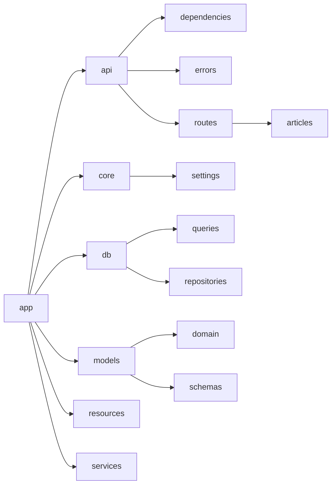

# Architecture Overview

The application is a FastAPI-based web service whose source code lives entirely within the `app` top-level package, which serves as the Python namespace unifying every component the service depends on [[target/app]]. Its [`main.py`](target/app/main.py) defines and immediately calls `get_application`, a factory that attaches middleware, registers lifecycle handlers, installs error handlers, and mounts the API router before returning a fully assembled ASGI-compatible `app` object ready for a server to run [[target/app]].

The foundational layer is the `core` package, which provides configuration, lifecycle management, and logging integration for the rest of the application [[target/app/core]]. Configuration is served through a hierarchy of environment-aware Pydantic settings classes — `BaseAppSettings`, `AppSettings`, `DevAppSettings`, `ProdAppSettings`, and `TestAppSettings` — each narrowing defaults to its deployment context [[target/app/core/settings]]. `get_app_settings` sits on top of that hierarchy as a single `@lru_cache`-decorated access point, reading the active environment once and returning a shared, cached instance so environment variables are never re-read at runtime [[target/app/core/settings]]. Lifecycle management is handled by a symmetric pair of factory functions: `create_start_app_handler` returns an async callable that opens the database connection on startup, and `create_stop_app_handler` returns a coroutine decorated with `@logger.catch` that closes it gracefully on shutdown [[target/app/core]]. Logging is unified by `InterceptHandler`, a `logging.Handler` subclass that translates every standard `LogRecord` into a Loguru call — resolving the level, walking the call stack, and forwarding exception context — so all output routes through a single sink regardless of which logging API the emitting code uses [[target/app/core]].

Persistent storage is the responsibility of the `db` package, which covers the full lifecycle of database access from connection pooling through query execution and domain-object hydration [[target/app/db]]. At startup, `connect_to_db` creates an asyncpg connection pool and attaches it to `app.state.pool`; at shutdown, `close_db_connection` tears it down [[target/app/db]]. The single shared exception type, `EntityDoesNotExist`, is a lightweight sentinel raised by any repository whenever a requested record cannot be found [[target/app/db]]. Raw SQL access is centralised in the `queries` subpackage, which parses every `.sql` file at import time using `aiosql` and the asyncpg adapter, assembling them into one object whose named queries are available as plain attributes [[target/app/db/queries]]. Alongside those static queries, five pypika table descriptors — `Users`, `Articles`, `Tags`, `ArticlesToTags`, and `Favorites` — are instantiated once as module-level singletons so dynamic query construction can reference them directly without scattering table names across the codebase [[target/app/db/queries]]. Domain-object hydration is the responsibility of the `repositories` subpackage, where every repository class inherits from `BaseRepository`, which stores an asyncpg `Connection` and exposes it through a read-only property, giving every subclass a uniform path to the database [[target/app/db/repositories]]. `UsersRepository` owns user-record persistence, while `ProfilesRepository` constructs an internal `UsersRepository` bound to the same connection to assemble full `Profile` objects with a `following` flag [[target/app/db/repositories]]. `TagsRepository` provides idempotent tag writes and flat enumeration [[target/app/db/repositories]]. The most complex repository, `ArticlesRepository`, coordinates internally with both `ProfilesRepository` and `TagsRepository` over the same connection so that a single operation can resolve author profiles, tag associations, and favourites data without multiplying connections, with all write operations running inside transactions [[target/app/db/repositories]]. `CommentsRepository` follows the same collaborative pattern, holding an internal `ProfilesRepository` and routing all row hydration through a private helper across four public methods covering the full comment lifecycle [[target/app/db/repositories]].

The type system of the application is organised by the `models` package into shared utilities, domain objects, and API contract schemas [[target/app/models]]. Two mixin classes in `common.py` compose freely with any downstream model: `IDModelMixin` supplies an integer `id_` field aliased to `"id"`, and `DateTimeModelMixin` adds `created_at` and `updated_at` fields that are auto-populated at instantiation [[target/app/models]]. The `domain` subpackage represents validated data as it moves through the codebase after being read from storage or accepted from a client [[target/app/models/domain]]. All domain models inherit from `RWModel`, which automatically converts snake\_case attribute names to camelCase JSON aliases, serialises `datetime` values to compact UTC strings ending in `Z`, and permits construction via either the Python name or its generated alias, applying these serialisation rules uniformly across the entire domain layer without per-field annotation [[target/app/models/domain]]. `Profile` is the simplest domain model, carrying the four user-visible fields and acting as the shared authorship type embedded in both articles and comments [[target/app/models/domain]]. User identity is split across `User`, which holds in-memory fields without credential material, and `UserInDB`, which composes `IDModelMixin`, `DateTimeModelMixin`, a salt, and a hashed password, and encapsulates all credential logic directly through `change_password` and `check_password` methods [[target/app/models/domain]]. `Article` and `Comment` both compose `IDModelMixin`, `DateTimeModelMixin`, and `RWModel` to inherit identity, timestamps, and serialisation, with `Article` adding eight content and authorship fields and `Comment` contributing only a `body` and an `author` `Profile` on top of the inherited ones [[target/app/models/domain]]. The `schemas` subpackage extends this foundation for the API boundary: its base class `RWSchema` adds `orm_mode = True` to `RWModel` so that schema instances can be constructed directly from database rows [[target/app/models/schemas]]. On top of that, the schemas subpackage provides the complete set of request and response shapes — covering users, JWT tokens, articles with pagination constants, comments, profiles, and tags — that the route layer validates and returns [[target/app/models/schemas]].

Business logic that sits between the API and the database is contained in the `services` package [[target/app/services]]. Credential availability checks translate repository-level `EntityDoesNotExist` exceptions into plain booleans through `check_email_is_taken` and `check_username_is_taken` [[target/app/services]]. Article helpers enforce ownership rules via `check_user_can_modify_article` and centralise slug generation through `get_slug_for_article`, which delegates to the `slugify` library [[target/app/services]]. A parallel `check_user_can_modify_comment` function applies the same ownership-check pattern for comments [[target/app/services]]. JWT issuance and decoding are concentrated in a pair of functions: `create_access_token_for_user` builds and signs a token using `HS256` with a fixed one-week expiry, and `get_username_from_token` decodes it and raises a descriptive `ValueError` on failure [[target/app/services]]. Password security is handled by a shared bcrypt `CryptContext` whose `generate_salt`, `get_password_hash`, and `verify_password` functions form a complementary pair for storing and authenticating credentials [[target/app/services]].

The `resources` package plays a narrow but important supporting role: its [`strings.py`](target/app/resources/strings.py) module declares every user-facing error and status message as a named constant, covering user, article, follow, authentication, and comment error conditions, so all client-visible text remains consistent and can be updated in one location rather than hunted across the application [[target/app/resources]].

The HTTP surface of the application is assembled by the `api` package, composed of three specialised sub-packages — `dependencies`, `errors`, and `routes` — that together handle routing, dependency injection, and error shaping [[target/app/api]]. The `dependencies` sub-package keeps all infrastructure wiring out of route handlers: `get_repository` manages the per-request connection lifecycle by acquiring a connection from `app.state.pool` and binding it to any requested `BaseRepository` subclass, and `get_current_user_authorizer` produces either a strict or relaxed JWT-verification dependency so each route can declare exactly the level of identity resolution it needs [[target/app/api/dependencies]]. Resource-specific chains extend that foundation — the articles module resolves articles by URL slug and enforces modification ownership, the comments module does the same for comments scoped to their parent article, and the profiles module resolves a profile by username while tolerating anonymous callers — with resource-not-found conditions converted to HTTP 404 and permission failures to HTTP 403 at the dependency boundary so that route handlers carry no authorization boilerplate of their own [[target/app/api/dependencies]]. The `errors` sub-package ensures every error the application surfaces is returned in a uniform `{"errors": [...]}` envelope: `http_error_handler` wraps any `HTTPException` detail in that structure while preserving the original status code, and `http422_error_handler` extracts structured validation details via `exc.errors()` and returns them with HTTP 422, with the validation module also patching the OpenAPI schema at import time so that live responses and generated documentation remain consistent [[target/app/api/errors]]. The `routes` sub-package is the complete HTTP surface, with its central `api.py` assembling six domain sub-routers — authentication, users, profiles, articles, comments, and tags — into a single mountable router that `main.py` registers in one step [[target/app/api/routes]]. Authentication endpoints handle registration and login; the current-user resource handles account retrieval and update with fresh JWT issuance on every successful response; the profiles router covers retrieval, following, and unfollowing with guards against self-targeting and redundant state changes; the articles domain is the largest and is split into its own sub-package, with core CRUD in `articles_resource.py` and a personalised feed alongside favouriting actions in `articles_common.py`; comments cover the full create, list, and ownership-enforced delete lifecycle; and a single tag endpoint enumerates every stored tag [[target/app/api/routes]] [[target/app/api/routes/articles]].

## Packages

### app

The `app` package is the top-level Python namespace for the entire service, with its [`__init__.py`](target/app/__init__.py) marking the directory as a package so that all submodules and components are importable by the rest of the codebase [[target/app/__init__.py]]. Everything the application needs — HTTP routing, configuration, persistence, domain types, shared text, and business logic — is organised into seven focused subpackages that collaborate through well-defined boundaries [[target/app]].

The entry point that wires them all together is [`main.py`](target/app/main.py), which defines and immediately invokes `get_application` to produce the ASGI-compatible `app` object [[target/app/main.py]]. That factory retrieves settings, attaches `CORSMiddleware`, registers startup and shutdown lifecycle handlers, installs the two application-level error handlers, and mounts the API router under the configured URL prefix before returning the fully assembled `FastAPI` instance [[target/app/main.py::get_application]].

The foundational layer is the `core` package, which supplies configuration, lifecycle management, and logging [[target/app/core]]. `get_app_settings` reads the active environment once and returns a cached settings instance so environment variables are never re-read at runtime [[target/app/core/config.py::get_app_settings]], `create_start_app_handler` and `create_stop_app_handler` produce the async callables that open and close the database connection around the application's lifespan [[target/app/core/events.py::create_start_app_handler]] [[target/app/core/events.py::create_stop_app_handler]], and `InterceptHandler` bridges the standard `logging` machinery to Loguru so that all log output is routed through a single sink regardless of which logging API the emitting code uses [[target/app/core/logging.py::InterceptHandler]].

Persistent storage is the responsibility of the `db` package, which covers the full lifecycle of database access [[target/app/db]]. `connect_to_db` creates an asyncpg connection pool at startup and attaches it to `app.state.pool`, while `close_db_connection` tears it down gracefully [[target/app/db/events.py::connect_to_db]] [[target/app/db/events.py::close_db_connection]]. Raw queries are centralised in the `queries` subpackage, where every `.sql` file is parsed at import time into a single object of named attributes, and pypika table descriptors for `Users`, `Articles`, `Tags`, `ArticlesToTags`, and `Favorites` support dynamic query construction without scattering table names across the codebase [[target/app/db/queries/tables.py::Users]] [[target/app/db/queries/tables.py::Articles]] [[target/app/db/queries/tables.py::Tags]] [[target/app/db/queries/tables.py::ArticlesToTags]] [[target/app/db/queries/tables.py::Favorites]]. Domain-object hydration is handled by the `repositories` subpackage: all repository classes inherit from `BaseRepository` for a uniform connection interface [[target/app/db/repositories/base.py::BaseRepository]], and the more complex repositories — `ArticlesRepository` and `CommentsRepository` — coordinate internally with `ProfilesRepository` and `TagsRepository` over the same connection so that a single operation can resolve author profiles, tags, and favourites without multiplying connections [[target/app/db/repositories/articles.py::ArticlesRepository]] [[target/app/db/repositories/comments.py::CommentsRepository]]. The single shared exception type, `EntityDoesNotExist`, is raised by any repository whenever a requested record cannot be found [[target/app/db/errors.py::EntityDoesNotExist]].

The type system of the application lives in the `models` package, organised into shared utilities, domain objects, and API contract schemas [[target/app/models]]. Two mixin classes in `common.py` — `IDModelMixin` for an `"id"`-aliased integer field and `DateTimeModelMixin` for auto-populated timestamps — compose freely with any downstream model to eliminate repetitive boilerplate [[target/app/models/common.py::IDModelMixin]] [[target/app/models/common.py::DateTimeModelMixin]]. All domain models inherit from `RWModel`, which enforces camelCase aliases and compact UTC datetime serialisation uniformly across the entire domain layer [[target/app/models/domain/rwmodel.py::RWModel]]. The domain objects themselves cover users (split into `User` for in-memory use and `UserInDB` for credential management), profiles, articles, and comments, with `Profile` serving as the shared authorship type embedded in both articles and comments [[target/app/models/domain/users.py::User]] [[target/app/models/domain/users.py::UserInDB]] [[target/app/models/domain/articles.py::Article]] [[target/app/models/domain/comments.py::Comment]]. The `schemas` subpackage extends `RWModel` further via `RWSchema`, which adds `orm_mode = True` so schemas can be constructed directly from database rows [[target/app/models/schemas/rwschema.py::RWSchema]], and provides the full set of request and response shapes for users, articles, comments, profiles, tags, and JWT tokens [[target/app/models/schemas/users.py::UserInResponse]] [[target/app/models/schemas/articles.py::ListOfArticlesInResponse]] [[target/app/models/schemas/jwt.py::JWTMeta]] [[target/app/models/schemas/jwt.py::JWTUser]].

Business logic that sits between the API and the database is contained in the `services` package [[target/app/services]]. Credential availability checks translate repository-level `EntityDoesNotExist` exceptions into plain booleans [[target/app/services/authentication.py::check_email_is_taken]] [[target/app/services/authentication.py::check_username_is_taken]], article and comment helpers enforce ownership rules and centralise slug generation [[target/app/services/articles.py::check_user_can_modify_article]] [[target/app/services/articles.py::get_slug_for_article]] [[target/app/services/comments.py::check_user_can_modify_comment]], JWT issuance and decoding are handled by dedicated functions built on `HS256` with a fixed one-week expiry [[target/app/services/jwt.py::create_access_token_for_user]] [[target/app/services/jwt.py::get_username_from_token]], and password security is concentrated in a shared bcrypt `CryptContext` whose `generate_salt`, `get_password_hash`, and `verify_password` functions form a complementary pair for storing and authenticating credentials [[target/app/services/security.py::generate_salt]] [[target/app/services/security.py::get_password_hash]] [[target/app/services/security.py::verify_password]].

The `resources` package plays a narrow but important role: its [`strings.py`](target/app/resources/strings.py) module declares every user-facing error and status message as a named constant, so any code path that needs to surface a message to a client can import it by name rather than embedding a raw string literal, keeping all client-visible text consistent and maintainable in a single location [[target/app/resources/strings.py]].

The HTTP surface of the application is assembled by the `api` package, which is composed of routing, dependency injection, and error shaping [[target/app/api]]. The `dependencies` sub-package keeps all infrastructure wiring out of route handlers: `get_repository` manages the per-request connection lifecycle [[target/app/api/dependencies/database.py::get_repository]], `get_current_user_authorizer` produces strict or relaxed JWT-verification dependencies as needed [[target/app/api/dependencies/authentication.py::get_current_user_authorizer]], and resource-specific chains resolve articles, comments, and profiles by their URL identifiers while converting not-found conditions to HTTP 404 and permission failures to HTTP 403 at the dependency boundary [[target/app/api/dependencies/articles.py::get_article_by_slug_from_path]] [[target/app/api/dependencies/comments.py::get_comment_by_id_from_path]] [[target/app/api/dependencies/profiles.py::get_profile_by_username_from_path]]. The `errors` sub-package ensures every error, whether an `HTTPException` or a Pydantic validation failure, is returned in a uniform `{"errors": [...]}` envelope that matches the shape advertised in the generated OpenAPI documentation [[target/app/api/errors/http_error.py::http_error_handler]] [[target/app/api/errors/validation_error.py::http422_error_handler]]. Finally, `routes/api.py` assembles six domain sub-routers — authentication, users, profiles, articles, comments, and tags — into a single mountable router that `main.py` registers in one step [[target/app/api/routes/api.py]], covering the full HTTP surface from registration and login through article CRUD, personalised feeds, favouriting, comment management, and tag retrieval [[target/app/api/routes/authentication.py::register]] [[target/app/api/routes/articles/articles_resource.py]] [[target/app/api/routes/comments.py::create_comment_for_article]] [[target/app/api/routes/tags.py::get_all_tags]].

### api

The `api` package is the complete HTTP-facing layer of the application, composed of three specialised sub-packages — `dependencies`, `errors`, and `routes` — that together handle routing, dependency injection, and error shaping for every endpoint the service exposes [[target/app/api]]. The package's own `__init__.py` is intentionally minimal, acting solely as a namespace marker so that the rest of the codebase can import from `app.api` without any bootstrapping logic living at the top level [[target/app/api/__init__.py]].

The `dependencies` sub-package provides all of the infrastructure wiring that route handlers rely on, keeping that concern entirely out of the routes themselves [[target/app/api/dependencies]]. At its core, the database module establishes the per-request connection lifecycle and exposes a `get_repository` factory that any handler can use to instantiate a repository bound to the current connection [[target/app/api/dependencies/database.py::get_repository]]. Authentication is layered on top through `get_current_user_authorizer`, which produces either a strict or a relaxed JWT-verification dependency so each route can declare exactly the level of identity resolution it requires [[target/app/api/dependencies/authentication.py::get_current_user_authorizer]]. Resource-specific chains extend that foundation: the articles module resolves articles by URL slug and enforces modification ownership [[target/app/api/dependencies/articles.py::get_article_by_slug_from_path]] [[target/app/api/dependencies/articles.py::check_article_modification_permissions]], the comments module does the same for comments scoped to their parent article [[target/app/api/dependencies/comments.py::get_comment_by_id_from_path]] [[target/app/api/dependencies/comments.py::check_comment_modification_permissions]], and the profiles module resolves a profile by username while tolerating anonymous callers [[target/app/api/dependencies/profiles.py::get_profile_by_username_from_path]]. Across all of these modules, resource-not-found conditions are converted to HTTP 404 and permission failures to HTTP 403 at the dependency boundary, so route handlers carry no authorization boilerplate of their own [[target/app/api/dependencies/articles.py]] [[target/app/api/dependencies/comments.py]] [[target/app/api/dependencies/profiles.py]].

The `errors` sub-package ensures that every error the application surfaces — whether a general HTTP exception or a Pydantic validation failure — is returned in a uniform `{"errors": [...]}` envelope [[target/app/api/errors]]. The `http_error_handler` function handles all `HTTPException` instances by wrapping their detail in that structure and preserving the original status code [[target/app/api/errors/http_error.py::http_error_handler]], while `http422_error_handler` handles validation failures by extracting structured details from `exc.errors()` and returning them with HTTP 422 [[target/app/api/errors/validation_error.py::http422_error_handler]]. The validation module also patches the OpenAPI schema at import time so that the generated documentation advertises the same envelope shape, keeping live responses and static documentation consistent [[target/app/api/errors/validation_error.py]].

The `routes` sub-package is the complete HTTP surface of the application, and its central `api.py` assembles six domain sub-routers into a single mountable router that the application can register in one step [[target/app/api/routes/api.py]]. Authentication endpoints for registration and login are provided by `routes/authentication.py` [[target/app/api/routes/authentication.py::register]] [[target/app/api/routes/authentication.py::login]], and the current user's own account retrieval and update are handled by `routes/users.py` [[target/app/api/routes/users.py::retrieve_current_user]] [[target/app/api/routes/users.py::update_current_user]]. Social graph operations — profile retrieval, following, and unfollowing — live in `routes/profiles.py`, with both mutation endpoints guarding against self-targeting and redundant state changes [[target/app/api/routes/profiles.py::follow_for_user]] [[target/app/api/routes/profiles.py::unsubscribe_from_user]]. The articles domain is the largest and is organised as its own sub-package, with core CRUD covered by `articles_resource.py` [[target/app/api/routes/articles/articles_resource.py]] and the personalised feed and favouriting actions provided by `articles_common.py` [[target/app/api/routes/articles/articles_common.py::get_articles_for_user_feed]] [[target/app/api/routes/articles/articles_common.py::mark_article_as_favorite]] [[target/app/api/routes/articles/articles_common.py::remove_article_from_favorites]]. Comment management is handled by `routes/comments.py`, covering creation, listing for anonymous callers, and ownership-enforced deletion [[target/app/api/routes/comments.py::create_comment_for_article]] [[target/app/api/routes/comments.py::list_comments_for_article]] [[target/app/api/routes/comments.py::delete_comment_from_article]], and tag retrieval is served by a single endpoint in `routes/tags.py` [[target/app/api/routes/tags.py::get_all_tags]].

### dependencies

The `dependencies` package groups all FastAPI dependency functions for the application's API layer into one importable namespace [[target/app/api/dependencies]]. Its [`__init__.py`](target/app/api/dependencies/__init__.py) is intentionally empty, acting only as a package marker and defining no symbols of its own [[target/app/api/dependencies/__init__.py]].

The foundation of the package is [`database.py`](target/app/api/dependencies/database.py), which establishes the three-level chain that every other module in the package relies on: it retrieves the application-level connection pool from `request.app.state.pool`, acquires a single connection from that pool for the lifetime of the request, and exposes a `get_repository` factory that instantiates any `BaseRepository` subclass bound to that connection [[target/app/api/dependencies/database.py]].

Authentication is handled entirely by [`authentication.py`](target/app/api/dependencies/authentication.py), which covers JWT Bearer token extraction, validation, and user resolution [[target/app/api/dependencies/authentication.py]]. It provides a public factory, `get_current_user_authorizer`, that returns either a strict dependency requiring a valid token or a relaxed variant that returns `None` for unauthenticated callers, so each route can declare exactly the level of authentication it needs [[target/app/api/dependencies/authentication.py::get_current_user_authorizer]].

Building on both of those foundations, [`articles.py`](target/app/api/dependencies/articles.py), [`comments.py`](target/app/api/dependencies/comments.py), and [`profiles.py`](target/app/api/dependencies/profiles.py) each provide resource-specific dependency chains. The articles module resolves an article by its URL slug, supports optional authentication during lookup, and adds a second dependency that enforces ownership before any modification is allowed, raising HTTP 403 when the check fails [[target/app/api/dependencies/articles.py::get_article_by_slug_from_path]] [[target/app/api/dependencies/articles.py::check_article_modification_permissions]]. It also supplies an independent `get_articles_filters` dependency that collects and validates up to five optional query-string parameters into a single `ArticlesFilters` object [[target/app/api/dependencies/articles.py::get_articles_filters]]. The comments module follows the same two-level pattern: `get_comment_by_id_from_path` resolves a comment scoped to its parent article and converts a missing comment into an HTTP 404, while `check_comment_modification_permissions` layers ownership enforcement on top and raises HTTP 403 for unauthorized callers [[target/app/api/dependencies/comments.py::get_comment_by_id_from_path]] [[target/app/api/dependencies/comments.py::check_comment_modification_permissions]]. The profiles module is a single-function provider: `get_profile_by_username_from_path` reads a username from the URL path, uses optional authentication so the endpoint remains accessible to anonymous callers while still enriching the response with relationship state when a user is present, and translates a missing profile into an HTTP 404 [[target/app/api/dependencies/profiles.py::get_profile_by_username_from_path]].

Across all five submodules the same structural contract repeats: database connectivity flows in through `get_repository`, authentication state flows in through `get_current_user_authorizer`, resource existence errors are translated into HTTP 404 responses at the dependency boundary, and permission failures are translated into HTTP 403 responses, so that route handlers themselves remain free of both infrastructure wiring and authorization boilerplate [[target/app/api/dependencies/database.py::get_repository]] [[target/app/api/dependencies/authentication.py::get_current_user_authorizer]] [[target/app/api/dependencies/articles.py]] [[target/app/api/dependencies/comments.py]] [[target/app/api/dependencies/profiles.py]].

### errors

The `errors` package serves as the centralised error-handling layer for the FastAPI application's API tier, grouping the modules responsible for shaping all error responses into a consistent `{"errors": [...]}` envelope [[target/app/api/errors]]. The directory is declared as a Python package by an empty initialiser that provides no definitions of its own but establishes the `app.api.errors` import namespace for the sibling modules it contains [[target/app/api/errors/__init__.py]].

Two handler modules live inside the package, each targeting a distinct error category. The first, [`http_error.py`](target/app/api/errors/http_error.py), handles general HTTP exceptions by exposing `http_error_handler`, which receives a request and an `HTTPException`, wraps the exception's detail in the shared `{"errors": [...]}` list structure, and returns a `JSONResponse` preserving the original status code [[target/app/api/errors/http_error.py::http_error_handler]]. The second, [`validation_error.py`](target/app/api/errors/validation_error.py), addresses input-validation failures on two fronts: at import time it patches the OpenAPI schema definition so that the generated documentation advertises the same `{"errors": ...}` envelope shape, and at runtime its `http422_error_handler` function extracts structured validation details via `exc.errors()` and returns them in that same envelope with HTTP 422 Unprocessable Entity [[target/app/api/errors/validation_error.py]] [[target/app/api/errors/validation_error.py::http422_error_handler]]. Together the two modules ensure that both the live API responses and the static OpenAPI documentation remain consistent in structure for every error the application can surface [[target/app/api/errors/http_error.py]] [[target/app/api/errors/validation_error.py]].

### routes

The `routes` package is the complete HTTP routing layer of the application, organising every API endpoint into domain-focused modules that are ultimately wired together into a single mountable router [[target/app/api/routes]]. Its [`__init__.py`](target/app/api/routes/__init__.py) marks the directory as an importable Python package without exporting anything of its own, allowing other parts of the codebase to reference the modules it contains [[target/app/api/routes/__init__.py]].

The assembly point is [`api.py`](target/app/api/routes/api.py), which creates a root `APIRouter` and mounts all six domain sub-routers onto it — authentication under `/users`, the current-user resource under `/user`, profiles under `/profiles`, articles at the root prefix, comments under `/articles/{slug}/comments`, and tags under `/tags` — so that the application can register the entire API surface in a single step [[target/app/api/routes/api.py]].

Authentication endpoints are handled by [`authentication.py`](target/app/api/routes/authentication.py), which exposes `POST /api/users` for registration and `POST /api/users/login` for login; both routes validate uniqueness or credential correctness before minting a JWT and returning a `UserInResponse` wrapping a `UserWithToken` [[target/app/api/routes/authentication.py::register]] [[target/app/api/routes/authentication.py::login]]. The authenticated user's own account is served by [`users.py`](target/app/api/routes/users.py), which provides `GET /api/user` to retrieve the current profile and `PUT /api/user` to update it, enforcing username and email uniqueness on updates and re-issuing a fresh JWT on every successful response [[target/app/api/routes/users.py::retrieve_current_user]] [[target/app/api/routes/users.py::update_current_user]].

Social graph operations live in [`profiles.py`](target/app/api/routes/profiles.py), which registers `GET /api/profiles/{username}` for profile retrieval, `POST /api/profiles/{username}/follow` to follow another user, and `DELETE /api/profiles/{username}/follow` to unfollow, with both mutation handlers guarding against self-targeting and redundant state changes via `HTTP_400_BAD_REQUEST` [[target/app/api/routes/profiles.py::follow_for_user]] [[target/app/api/routes/profiles.py::unsubscribe_from_user]].

The articles domain is the largest and is broken into its own sub-package [[target/app/api/routes/articles]]. Its internal [`api.py`](target/app/api/routes/articles/api.py) stitches together two sibling modules under the `/articles` prefix [[target/app/api/routes/articles/api.py]]. [`articles_resource.py`](target/app/api/routes/articles/articles_resource.py) covers the core CRUD lifecycle — listing with optional filters, creating with duplicate-slug detection, retrieving by slug, updating with permission enforcement, and deleting with a 204 response [[target/app/api/routes/articles/articles_resource.py]]. [`articles_common.py`](target/app/api/routes/articles/articles_common.py) extends that surface with a personalised feed at `GET /api/articles/feed` and favouriting actions at `POST` and `DELETE /api/articles/{slug}/favorite`, all three raising HTTP 400 on precondition violations and resolving the acting user via shared dependency-injection helpers [[target/app/api/routes/articles/articles_common.py::get_articles_for_user_feed]] [[target/app/api/routes/articles/articles_common.py::mark_article_as_favorite]] [[target/app/api/routes/articles/articles_common.py::remove_article_from_favorites]].

Article comments are handled by [`comments.py`](target/app/api/routes/comments.py), which covers the full create/read/delete lifecycle: `POST /api/articles/{slug}/comments` requires authentication and returns HTTP 201, `GET /api/articles/{slug}/comments` accepts anonymous callers and returns a `ListOfCommentsInResponse`, and `DELETE /api/articles/{slug}/comments/{comment_id}` enforces ownership via `check_comment_modification_permissions` before responding with HTTP 204 [[target/app/api/routes/comments.py::create_comment_for_article]] [[target/app/api/routes/comments.py::list_comments_for_article]] [[target/app/api/routes/comments.py::delete_comment_from_article]]. Finally, [`tags.py`](target/app/api/routes/tags.py) registers a single `GET /api/tags` endpoint that retrieves every tag from the database and returns the results in a `TagsInList` response [[target/app/api/routes/tags.py::get_all_tags]].

### articles

The `articles` package forms a self-contained routing layer that delivers the complete articles API to the rest of the application [[target/app/api/routes/articles]]. Its [`__init__.py`](target/app/api/routes/articles/__init__.py) marks the directory as an importable Python package so that other parts of the codebase can reference its contents [[target/app/api/routes/articles/__init__.py]].

The package is divided across two functional modules that are stitched together by a single aggregator. [`api.py`](target/app/api/routes/articles/api.py) acts as that aggregator: it imports the routers from both sibling modules, mounts each under the `/articles` prefix, and exposes one unified `router` object for registration elsewhere in the application [[target/app/api/routes/articles/api.py]].

[`articles_resource.py`](target/app/api/routes/articles/articles_resource.py) covers the core CRUD lifecycle of an article [[target/app/api/routes/articles/articles_resource.py]]. `list_articles` handles `GET /api/articles` with optional authentication, filtering by tag, author, or favourited state, and returns a paginated `ListOfArticlesInResponse` [[target/app/api/routes/articles/articles_resource.py::list_articles]]. `create_new_article` handles `POST /api/articles`, derives a URL-safe slug from the title, and rejects the request with HTTP 400 if that slug already exists [[target/app/api/routes/articles/articles_resource.py::create_new_article]]. `retrieve_article_by_slug` handles `GET /api/articles/{slug}` and returns the resolved article wrapped in an `ArticleInResponse` [[target/app/api/routes/articles/articles_resource.py::retrieve_article_by_slug]]. `update_article_by_slug` handles `PUT /api/articles/{slug}` and enforces write-access via `check_article_modification_permissions` before applying changes and re-deriving the slug when a new title is supplied [[target/app/api/routes/articles/articles_resource.py::update_article_by_slug]]. `delete_article_by_slug` handles `DELETE /api/articles/{slug}`, applies the same permission guard, and responds with HTTP 204 No Content after permanent removal [[target/app/api/routes/articles/articles_resource.py::delete_article_by_slug]].

[`articles_common.py`](target/app/api/routes/articles/articles_common.py) extends that surface with feed and favouriting behaviour [[target/app/api/routes/articles/articles_common.py]]. `get_articles_for_user_feed` handles `GET /api/articles/feed`, returning a paginated and personalised article feed for the authenticated caller using `limit` and `offset` parameters [[target/app/api/routes/articles/articles_common.py::get_articles_for_user_feed]]. `mark_article_as_favorite` handles `POST /api/articles/{slug}/favorite`, persisting the favouriting relationship and returning the updated article; it raises HTTP 400 if the article is already favourited [[target/app/api/routes/articles/articles_common.py::mark_article_as_favorite]]. `remove_article_from_favorites` mirrors that logic on `DELETE /api/articles/{slug}/favorite`, decrementing `favorites_count` and patching `favorited` to `False`, or raising HTTP 400 if the article was not previously favourited [[target/app/api/routes/articles/articles_common.py::remove_article_from_favorites]]. All three handlers share a consistent dependency-injection pattern, resolving the acting user via `get_current_user_authorizer` and the data layer via `get_repository` [[target/app/api/routes/articles/articles_common.py::get_articles_for_user_feed]] [[target/app/api/routes/articles/articles_common.py::mark_article_as_favorite]] [[target/app/api/routes/articles/articles_common.py::remove_article_from_favorites]].

### core

The `core` package is the application's foundational layer, bundling configuration, lifecycle management, and logging setup into a single cohesive unit [[target/app/core]]. Its [`__init__.py`](target/app/core/__init__.py) is a marker file that does nothing beyond making the directory a recognisable Python package, so all meaningful behaviour lives in the submodules and the nested `settings` package [[target/app/core/__init__.py]].

Configuration is handled through two complementary layers. The [`settings`](target/app/core/settings) sub-package defines the full hierarchy of environment-aware classes — `BaseAppSettings`, `AppSettings`, `DevAppSettings`, `ProdAppSettings`, and `TestAppSettings` — together with the `AppEnvTypes` enum that names the three supported deployment contexts [[target/app/core/settings]]. [`config.py`](target/app/core/config.py) sits on top of that hierarchy as the single access point for the rest of the application: it maps each `AppEnvTypes` value to its corresponding settings class, and exposes `get_app_settings`, an `@lru_cache`-decorated factory that reads the current environment, looks up the right class, and returns one shared, cached instance so that environment variables are read only once [[target/app/core/config.py::get_app_settings]].

Application lifecycle is managed by [`events.py`](target/app/core/events.py), which provides a symmetric pair of factory functions [[target/app/core/events.py]]. `create_start_app_handler` accepts the `FastAPI` app and an `AppSettings` object and returns an async callable that opens the database connection by delegating to `connect_to_db` on startup [[target/app/core/events.py::create_start_app_handler]]. `create_stop_app_handler` mirrors that pattern for teardown, returning a coroutine decorated with `@logger.catch` so that any exception raised while closing the database connection is captured and logged rather than left to propagate [[target/app/core/events.py::create_stop_app_handler]].

Logging integration is provided by [`logging.py`](target/app/core/logging.py), whose sole responsibility is bridging Python's standard `logging` infrastructure to the Loguru library [[target/app/core/logging.py]]. It defines `InterceptHandler`, a `logging.Handler` subclass whose `emit` method translates every standard `LogRecord` into a Loguru call — resolving the level name, walking the call stack to identify the true call site, and forwarding any exception context — so that all log output flows through Loguru regardless of which logging API the emitting code uses [[target/app/core/logging.py::InterceptHandler]].

### settings

The `settings` package is the central configuration layer for the application, grouping all environment-aware settings classes and their shared infrastructure into one place [[target/app/core/settings]]. Its initialiser module acts as the entry point for configuration-related imports, making the package's contents accessible to the rest of the application [[target/app/core/settings/__init__.py]].

The foundation is laid in [`base.py`](target/app/core/settings/base.py), which defines both the `AppEnvTypes` enumeration — recognising `prod`, `dev`, and `test` as the three valid deployment environments — and `BaseAppSettings`, the root Pydantic `BaseSettings` class from which all environment-specific classes inherit [[target/app/core/settings/base.py::AppEnvTypes]] [[target/app/core/settings/base.py::BaseAppSettings]]. `BaseAppSettings` declares a single `app_env` field defaulting to `AppEnvTypes.prod` and instructs Pydantic to populate values from a `.env` file, so deployment context can be changed without touching source code [[target/app/core/settings/base.py::BaseAppSettings]].

The bulk of the shared runtime configuration lives in [`app.py`](target/app/core/settings/app.py), where `AppSettings` extends `BaseAppSettings` and declares every field the application needs at runtime across four concerns: FastAPI metadata, database connectivity, security, and logging [[target/app/core/settings/app.py::AppSettings]]. Beyond being a passive data holder, `AppSettings` also exposes a `configure_logging` method that wires the entire logging pipeline through `InterceptHandler`, and a `fastapi_kwargs` method that assembles the framework's metadata fields into a dictionary ready to be unpacked at application construction time [[target/app/core/settings/app.py::AppSettings]].

The three environment-specific modules each extend `AppSettings` and narrow its defaults to a particular context. [`development.py`](target/app/core/settings/development.py) provides `DevAppSettings`, which enables `debug`, sets a development-oriented title, and raises the logging level to `DEBUG`, loading overrides from a `.env` file [[target/app/core/settings/development.py::DevAppSettings]]. [`production.py`](target/app/core/settings/production.py) provides `ProdAppSettings`, which loads from a `prod.env` file and explicitly fixes `app_env` to `AppEnvTypes.prod`, while leaving `database_url` and `secret_key` without defaults so they must be injected by the environment [[target/app/core/settings/production.py::ProdAppSettings]]. [`test.py`](target/app/core/settings/test.py) provides `TestAppSettings`, which also enables `debug` and `DEBUG`-level logging, hardcodes `secret_key` to a known value, and caps both connection counts at five so that tests run against a controlled, predictable baseline [[target/app/core/settings/test.py::TestAppSettings]]. Together, the three classes ensure that the same `AppSettings` contract is honoured in every environment while each context supplies only the values appropriate to it [[target/app/core/settings/development.py]] [[target/app/core/settings/production.py]] [[target/app/core/settings/test.py]].

### db

The `db` package is the complete database layer of the application, grouping all concerns that touch persistent storage into four focused submodules [[target/app/db]]. The [`__init__.py`](target/app/db/__init__.py) file establishes the `app.db` namespace and controls what the rest of the application sees when it imports the package [[target/app/db/__init__.py]].

Lifecycle management is handled by [`events.py`](target/app/db/events.py), which defines the startup and shutdown hooks that open and close an asyncpg connection pool around the application's lifespan [[target/app/db/events.py]]. At startup, `connect_to_db` creates the pool from settings-derived configuration and attaches it to `app.state.pool` so every part of the application can reach it [[target/app/db/events.py::connect_to_db]], while `close_db_connection` performs the complementary teardown when the application stops [[target/app/db/events.py::close_db_connection]].

The [`errors.py`](target/app/db/errors.py) module provides the single exception type shared across the entire layer [[target/app/db/errors.py]]. `EntityDoesNotExist` is a lightweight sentinel that extends Python's built-in `Exception` with no additional fields, raised whenever a requested record cannot be found in the database [[target/app/db/errors.py::EntityDoesNotExist]].

Raw SQL access is centralised in the [`queries`](target/app/db/queries) subpackage, which parses every `.sql` file in its `sql` directory at import time using `aiosql` and the `asyncpg` adapter, assembling them into a single object whose named queries are available as plain attributes [[target/app/db/queries]]. Alongside the static queries, the `tables` module supplies typed pypika table descriptors — `Users`, `Articles`, `Tags`, `ArticlesToTags`, and `Favorites` — each instantiated once as a module-level singleton so that dynamic query construction across the application can reference them directly [[target/app/db/queries/tables.py::Users]] [[target/app/db/queries/tables.py::Articles]] [[target/app/db/queries/tables.py::Tags]] [[target/app/db/queries/tables.py::ArticlesToTags]] [[target/app/db/queries/tables.py::Favorites]]. The `Parameter` helper rounds out the module by converting integer counts into asyncpg-style positional placeholders, keeping that formatting detail out of all higher-level query logic [[target/app/db/queries/tables.py::Parameter]].

Domain-object hydration lives in the [`repositories`](target/app/db/repositories) subpackage, where every repository class translates raw asyncpg rows into typed Python objects [[target/app/db/repositories]]. All repositories inherit from `BaseRepository`, which accepts an asyncpg `Connection` at construction and exposes it through a read-only property, giving every subclass a uniform path to the database [[target/app/db/repositories/base.py::BaseRepository]]. `UsersRepository` owns user-record persistence, handling creation, lookups by email or username, and selective updates while raising `EntityDoesNotExist` for missing records [[target/app/db/repositories/users.py::UsersRepository]]. `ProfilesRepository` builds on top of it by constructing an internal `UsersRepository` bound to the same connection in order to assemble full `Profile` domain objects with a `following` flag, and it wraps follow and unfollow operations in atomic transactions [[target/app/db/repositories/profiles.py::ProfilesRepository]]. Tag records are managed by `TagsRepository`, which provides idempotent writes and a flat enumeration of every stored tag [[target/app/db/repositories/tags.py::TagsRepository]]. The most involved repository, `ArticlesRepository`, coordinates internally with both `ProfilesRepository` and `TagsRepository` over the same connection so that a single article operation can resolve author profiles, tag associations, and favorites data without multiplying connections [[target/app/db/repositories/articles.py::ArticlesRepository]], with write operations running inside transactions and read operations covering both single-record and paginated collection lookups [[target/app/db/repositories/articles.py::ArticlesRepository]]. Finally, `CommentsRepository` follows the same collaborative pattern, holding an internal `ProfilesRepository` and routing all hydration through a private helper to cover the full comment lifecycle across four public methods [[target/app/db/repositories/comments.py::CommentsRepository]].

### queries

The `queries` package is the database query layer for the application, providing a clean boundary between the rest of the codebase and its SQL access patterns [[target/app/db/queries]].

The package's entry point re-exports pre-built query objects so that callers can import them directly without reaching into submodules [[target/app/db/queries/__init__.py]]. The actual query loading happens in [`queries.py`](target/app/db/queries/queries.py), which uses the `aiosql` library together with the `asyncpg` driver adapter to parse every `.sql` file in the adjacent `sql` directory at import time, assembling them into a single `queries` object whose named queries are accessible as plain attributes with no further registration required [[target/app/db/queries/queries.py]].

The companion module [`tables.py`](target/app/db/queries/tables.py) supplies the typed table descriptors and a query-parameter helper used when constructing dynamic queries [[target/app/db/queries/tables.py]]. All table descriptors extend `TypedTable`, a pypika `Table` subclass that resolves the underlying table name from an explicit argument, a `__table__` class attribute, or the class name itself [[target/app/db/queries/tables.py::TypedTable]]. Built on this foundation are five descriptors: `Users` for the `users` table with `id` and `username` fields, `Articles` for the `articles` table carrying the full set of content, authorship, and timestamp fields, `Tags` for the `tags` table with a single `tag` field, `ArticlesToTags` for the join table linking articles to their tags, and `Favorites` for the `favorites` table recording which users have favourited which articles [[target/app/db/queries/tables.py::Users]] [[target/app/db/queries/tables.py::Articles]] [[target/app/db/queries/tables.py::Tags]] [[target/app/db/queries/tables.py::ArticlesToTags]] [[target/app/db/queries/tables.py::Favorites]]. Each descriptor is instantiated once at module level as a shared singleton, so query-building code across the application references these objects directly rather than constructing new instances [[target/app/db/queries/tables.py]]. The `Parameter` class rounds out the module by formatting integer counts into asyncpg-style positional placeholders such as `$1` or `$2`, keeping placeholder details out of the query-building logic that uses it [[target/app/db/queries/tables.py::Parameter]].

### repositories

The `repositories` package is the database-access layer of the application, grouping every repository class that translates between raw asyncpg query results and typed domain objects [[target/app/db/repositories]]. The [`__init__.py`](target/app/db/repositories/__init__.py) file contains no logic of its own; it simply marks the directory as a Python package so that the individual repository modules can be imported as a cohesive unit [[target/app/db/repositories/__init__.py]].

All repositories share a common foundation defined in [`base.py`](target/app/db/repositories/base.py): `BaseRepository` accepts an asyncpg `Connection` at construction time, stores it in `_conn`, and exposes it through a read-only `connection` property, giving every subclass a consistent and uniform way to reach the database [[target/app/db/repositories/base.py::BaseRepository]].

User-record persistence lives in [`users.py`](target/app/db/repositories/users.py), whose `UsersRepository` handles creation, lookup by email, lookup by username, and selective updates, always hydrating results into `UserInDB` instances and raising `EntityDoesNotExist` when a requested record is absent [[target/app/db/repositories/users.py::UsersRepository]]. Building directly on top of that, [`profiles.py`](target/app/db/repositories/profiles.py) provides `ProfilesRepository`, which constructs an internal `UsersRepository` bound to the same connection so that it can assemble full `Profile` domain objects — including the `following` flag — without opening a second database connection [[target/app/db/repositories/profiles.py::ProfilesRepository]]. Follow relationships are managed through `add_user_into_followers` and `remove_user_from_followers`, both of which wrap their respective queries in atomic transactions [[target/app/db/repositories/profiles.py::ProfilesRepository]].

Tag records are handled by `TagsRepository` in [`tags.py`](target/app/db/repositories/tags.py), which exposes exactly two methods: `create_tags_that_dont_exist` for idempotent writes and `get_all_tags` for enumerating every stored tag as a flat list of strings [[target/app/db/repositories/tags.py::TagsRepository]].

The most complex module is [`articles.py`](target/app/db/repositories/articles.py), where `ArticlesRepository` coordinates with both `ProfilesRepository` and `TagsRepository` — sharing the same connection — so that a single article operation can resolve author profiles, tag associations, and favorites counts without multiplying connections [[target/app/db/repositories/articles.py::ArticlesRepository]]. Its private helper `_get_article_from_db_record` is the single hydration path that assembles a fully populated `Article` domain object from a raw row, including follow-aware author profiles and an optional `favorited` flag for a requesting user [[target/app/db/repositories/articles.py::ArticlesRepository]]. Write operations (`create_article`, `update_article`, `delete_article`) each run inside transactions, while read operations (`get_article_by_slug`, `filter_articles`, `get_articles_for_user_feed`) cover both single-record and paginated collection lookups [[target/app/db/repositories/articles.py::ArticlesRepository]]. Favorites management is rounded out by `is_article_favorited_by_user`, `add_article_into_favorites`, and `remove_article_from_favorites` [[target/app/db/repositories/articles.py::ArticlesRepository]].

Comment persistence follows the same pattern in [`comments.py`](target/app/db/repositories/comments.py): `CommentsRepository` holds an internal `ProfilesRepository` collaborator, routes every hydration through the private `_get_comment_from_db_record` helper, and exposes four public methods — `create_comment_for_article`, `get_comment_by_id`, `get_comments_for_article`, and `delete_comment` — that together cover the full comment lifecycle [[target/app/db/repositories/comments.py::CommentsRepository]].

### models

The `models` package is the central type system of the application, organising all Pydantic data structures into three distinct concerns: shared utilities, in-memory domain objects, and API contract schemas [[target/app/models]]. Its [`__init__.py`](target/app/models/__init__.py) contains no definitions of its own and exists purely to mark the directory as a Python package, making its submodules importable from the rest of the application [[target/app/models/__init__.py]].

The foundation shared across the entire package is established in [`common.py`](target/app/models/common.py), which provides two mixin classes that any model can inherit to avoid repeating boilerplate [[target/app/models/common.py]]. `IDModelMixin` supplies a single integer `id_` field aliased to `"id"`, allowing database rows or JSON payloads to use the conventional `"id"` key while the Python attribute avoids shadowing the built-in [[target/app/models/common.py::IDModelMixin]]. `DateTimeModelMixin` adds `created_at` and `updated_at` fields and attaches a pre-validator that automatically populates them with `datetime.datetime.now()` whenever the caller omits those values, ensuring timestamps are never left blank at instantiation [[target/app/models/common.py::DateTimeModelMixin::default_datetime]]. The two mixins are designed to be composed with each other and with application-specific models through multiple inheritance, so any downstream class gains consistent identity and timestamp behaviour in a single step [[target/app/models/common.py::IDModelMixin]] [[target/app/models/common.py::DateTimeModelMixin]].

The `domain` subpackage is the application's layer of in-memory types, representing validated data as it moves through the codebase after being read from storage or accepted from a client [[target/app/models/domain]]. All domain models ultimately inherit from `RWModel`, defined in [`rwmodel.py`](target/app/models/domain/rwmodel.py), which automatically converts snake\_case attribute names to camelCase JSON aliases, serialises `datetime` values to compact UTC strings ending in `Z`, and permits construction via either the Python name or the generated alias [[target/app/models/domain/rwmodel.py::RWModel]]. These three serialisation rules therefore apply uniformly to every model in the domain layer without per-field annotation [[target/app/models/domain/rwmodel.py]]. The simplest domain model is `Profile`, which carries the four fields describing a user as visible to others — `username`, `bio`, `image`, and `following` — and acts as the shared authorship type embedded in both articles and comments [[target/app/models/domain/profiles.py::Profile]]. User identity is split across two models in [`users.py`](target/app/models/domain/users.py): `User` holds the four in-memory fields (`username`, `email`, `bio`, and `image`) without any credential material, while `UserInDB` extends `User` with `IDModelMixin`, `DateTimeModelMixin`, `salt`, and `hashed_password`, and encapsulates all credential logic directly — `change_password` regenerates the salt and hash in place, and `check_password` verifies a plain-text password against the stored values [[target/app/models/domain/users.py::User]] [[target/app/models/domain/users.py::UserInDB]]. Published content is covered by `Article` and `Comment`, both of which compose `IDModelMixin`, `DateTimeModelMixin`, and `RWModel` to inherit identity, lifecycle timestamps, and serialisation behaviour [[target/app/models/domain/articles.py::Article]] [[target/app/models/domain/comments.py::Comment]]. `Article` adds eight fields of its own — `slug`, `title`, `description`, `body`, a `tags` list, an `author` `Profile`, `favorited`, and `favorites_count` — while `Comment` contributes only a `body` string and an `author` `Profile` on top of its inherited fields, both relying on the same `Profile` type to carry authorship in a consistent, already-validated form [[target/app/models/domain/articles.py]] [[target/app/models/domain/comments.py]].

The `schemas` subpackage is the API contract layer, grouping every Pydantic model that validates incoming request data and shapes outgoing response payloads [[target/app/models/schemas]]. All schema classes build on `RWSchema`, defined in [`rwschema.py`](target/app/models/schemas/rwschema.py), which extends `RWModel` with `orm_mode = True` so that instances can be constructed directly from database rows rather than only from plain dictionaries [[target/app/models/schemas/rwschema.py::RWSchema]]. User account flows are handled by [`users.py`](target/app/models/schemas/users.py), which defines the full lifecycle from sign-in through registration, authenticated response, and partial update: `UserInLogin` captures email and password, `UserInCreate` extends that with a `username` for registration, `UserWithToken` pairs profile fields with a session token, `UserInResponse` wraps that combination in a `user` envelope for API callers, and `UserInUpdate` makes all five editable profile fields optional so any subset constitutes a valid update [[target/app/models/schemas/users.py::UserInLogin]] [[target/app/models/schemas/users.py::UserInCreate]] [[target/app/models/schemas/users.py::UserWithToken]] [[target/app/models/schemas/users.py::UserInResponse]] [[target/app/models/schemas/users.py::UserInUpdate]]. JWT token structure is defined separately in [`jwt.py`](target/app/models/schemas/jwt.py), where `JWTMeta` carries token-level properties such as expiry and subject, and `JWTUser` carries the application-level username extracted after decoding [[target/app/models/schemas/jwt.py::JWTMeta]] [[target/app/models/schemas/jwt.py::JWTUser]]. Article schemas in [`articles.py`](target/app/models/schemas/articles.py) establish module-level pagination constants (`DEFAULT_ARTICLES_LIMIT` of 20 and `DEFAULT_ARTICLES_OFFSET` of 0) and organise their types into request, response, and filter shapes: `ArticleInCreate` collects the required title, description, and body with an optional tag list; `ArticleInUpdate` makes all three text fields optional for partial edits; `ArticleForResponse` is the central response building block with a `tagList`-aliased tags field; `ArticleInResponse` wraps it in a single `article` envelope; `ListOfArticlesInResponse` pairs a list of those objects with an `articles_count` integer; and `ArticlesFilters` bundles optional tag, author, and favorited query filters with constrained limit and offset fields, inheriting from `BaseModel` directly rather than `RWSchema` [[target/app/models/schemas/articles.py::ArticleInCreate]] [[target/app/models/schemas/articles.py::ArticleInUpdate]] [[target/app/models/schemas/articles.py::ArticleForResponse]] [[target/app/models/schemas/articles.py::ArticleInResponse]] [[target/app/models/schemas/articles.py::ListOfArticlesInResponse]] [[target/app/models/schemas/articles.py::ArticlesFilters]]. Comment operations follow the same pattern in [`comments.py`](target/app/models/schemas/comments.py): `CommentInCreate` validates a single `body` string on input, `CommentInResponse` wraps one `Comment` domain object for single-resource responses, and `ListOfCommentsInResponse` holds a list of `Comment` objects for collection responses [[target/app/models/schemas/comments.py::CommentInCreate]] [[target/app/models/schemas/comments.py::CommentInResponse]] [[target/app/models/schemas/comments.py::ListOfCommentsInResponse]]. Profile responses are handled by `ProfileInResponse` in [`profiles.py`](target/app/models/schemas/profiles.py), which wraps a `Profile` domain object under a `profile` key for API callers [[target/app/models/schemas/profiles.py::ProfileInResponse]], and tag collections are served by `TagsInList` in [`tags.py`](target/app/models/schemas/tags.py), a minimal model holding a `List[str]` of tag name strings as a structured, validated payload [[target/app/models/schemas/tags.py::TagsInList]].

### domain

The `domain` package is the application's canonical layer of in-memory data types, grouping together every validated model that the rest of the codebase passes around after data has been read from storage or accepted from a client [[target/app/models/domain]]. The [`__init__.py`](target/app/models/domain/__init__.py) file contains no definitions of its own; it exists purely to mark the directory as a Python package and make its siblings importable as part of the domain layer [[target/app/models/domain/__init__.py]].

The foundation on which all other models rest is defined in [`rwmodel.py`](target/app/models/domain/rwmodel.py). It provides `RWModel`, a fieldless Pydantic base class whose inner `Config` automatically converts every snake\_case Python attribute name to a camelCase JSON alias via `convert_field_to_camel_case`, serialises every `datetime.datetime` value to a compact UTC string ending in `Z` via `convert_datetime_to_realworld`, and permits construction using either the Python name or its generated alias [[target/app/models/domain/rwmodel.py::RWModel]]. Every other model in the package inherits from `RWModel`, meaning these three serialisation rules apply uniformly across the entire domain layer without per-field annotation [[target/app/models/domain/rwmodel.py]].

The simplest consumer of `RWModel` is `Profile`, defined in [`profiles.py`](target/app/models/domain/profiles.py). It captures the four pieces of information associated with a user profile visible to other users: a required `username` string, a `bio` string that defaults to empty, an optional `image` URL, and a `following` boolean indicating whether the authenticated caller follows that profile [[target/app/models/domain/profiles.py::Profile]]. Because `Profile` is embedded in both articles and comments, it acts as the shared authorship type across the package [[target/app/models/domain/profiles.py]].

User identity and credentials are handled by [`users.py`](target/app/models/domain/users.py). The `User` model extends `RWModel` with the four fields that describe an application user in memory — `username`, `email`, `bio`, and `image` — without storing any credential material [[target/app/models/domain/users.py::User]]. `UserInDB` then extends `User` further, composing in `IDModelMixin` and `DateTimeModelMixin` to add an integer primary key and `created_at`/`updated_at` timestamps, and appending `salt` and `hashed_password` fields for the stored credential [[target/app/models/domain/users.py::UserInDB]]. All password logic is encapsulated on `UserInDB` itself: `change_password` generates a fresh salt and recomputes the hash in place, while `check_password` verifies a plain-text password against the stored salt and hash, so no external code needs to call the security service directly for credential management [[target/app/models/domain/users.py::UserInDB]].

Published content is represented by [`articles.py`](target/app/models/domain/articles.py) and [`comments.py`](target/app/models/domain/comments.py). `Article` composes `IDModelMixin`, `DateTimeModelMixin`, and `RWModel` to inherit identity, lifecycle timestamps, and serialisation behaviour, then adds eight fields of its own: `slug`, `title`, `description`, `body`, a `tags` list, an `author` of type `Profile`, a `favorited` boolean, and a `favorites_count` integer [[target/app/models/domain/articles.py::Article]]. `Comment` follows the identical inheritance pattern — `IDModelMixin`, `DateTimeModelMixin`, and `RWModel` — gaining an `id_` primary key and `created_at`/`updated_at` timestamps, and contributing only a `body` string and an `author` `Profile` on top of those inherited fields [[target/app/models/domain/comments.py::Comment]]. Together, the two models represent every piece of user-generated content the application tracks, both relying on `Profile` to carry authorship information in a consistent, already-validated form [[target/app/models/domain/articles.py]] [[target/app/models/domain/comments.py]].

### schemas

The `schemas` package is the API contract layer of the application, grouping all Pydantic models that validate incoming request data and shape outgoing response payloads [[target/app/models/schemas]]. Its [`__init__.py`](target/app/models/schemas/__init__.py) marks the directory as a Python package, making every submodule importable as part of the broader application [[target/app/models/schemas/__init__.py]].

The shared serialisation foundation is provided by [`rwschema.py`](target/app/models/schemas/rwschema.py), which defines `RWSchema` — a thin subclass of `RWModel` that switches on `orm_mode = True`, allowing Pydantic to populate model instances directly from database rows rather than only from plain dictionaries [[target/app/models/schemas/rwschema.py::RWSchema]]. No new fields are added at this level; its sole job is to act as the bridge between the domain model layer and any schema class that must be constructed from persistence results [[target/app/models/schemas/rwschema.py::RWSchema]].

User-facing identity flows are covered by two submodules. [`users.py`](target/app/models/schemas/users.py) defines the full lifecycle of a user account: `UserInLogin` captures email and password for sign-in, `UserInCreate` extends that with a `username` field for registration, `UserWithToken` pairs domain profile fields with a session token for authenticated responses, `UserInResponse` wraps that combined object in a `user` envelope for API callers, and `UserInUpdate` exposes all five editable profile fields as optional so that any subset of changes constitutes a valid update payload [[target/app/models/schemas/users.py::UserInLogin]] [[target/app/models/schemas/users.py::UserInCreate]] [[target/app/models/schemas/users.py::UserWithToken]] [[target/app/models/schemas/users.py::UserInResponse]] [[target/app/models/schemas/users.py::UserInUpdate]]. [`jwt.py`](target/app/models/schemas/jwt.py) sits alongside it, defining `JWTMeta` to carry token-level properties such as expiry and subject, and `JWTUser` to carry the application-level username extracted once a token has been decoded [[target/app/models/schemas/jwt.py::JWTMeta]] [[target/app/models/schemas/jwt.py::JWTUser]].

Article data is handled by [`articles.py`](target/app/models/schemas/articles.py), which establishes module-level pagination constants `DEFAULT_ARTICLES_LIMIT` (20) and `DEFAULT_ARTICLES_OFFSET` (0) and organises its schemas into request, response, and filter shapes [[target/app/models/schemas/articles.py]]. `ArticleInCreate` collects the required title, description, and body plus an optional tag list, while `ArticleInUpdate` makes all three text fields optional for partial edits [[target/app/models/schemas/articles.py::ArticleInCreate]] [[target/app/models/schemas/articles.py::ArticleInUpdate]]. `ArticleForResponse` is the central response building block, combining domain article fields with a `tagList`-aliased tags field; `ArticleInResponse` wraps it in a single `article` envelope, and `ListOfArticlesInResponse` pairs a list of those objects with an `articles_count` integer for list endpoints [[target/app/models/schemas/articles.py::ArticleForResponse]] [[target/app/models/schemas/articles.py::ArticleInResponse]] [[target/app/models/schemas/articles.py::ListOfArticlesInResponse]]. `ArticlesFilters`, which inherits from `BaseModel` directly rather than `RWSchema`, bundles the optional tag, author, and favorited filters with constrained limit and offset pagination fields for query-parameter handling [[target/app/models/schemas/articles.py::ArticlesFilters]].

Comment operations are defined in [`comments.py`](target/app/models/schemas/comments.py), where `CommentInCreate` validates a single `body` string on input, `CommentInResponse` wraps a single `Comment` domain object for single-resource responses, and `ListOfCommentsInResponse` holds a list of `Comment` objects for collection responses, with all three classes inheriting from `RWSchema` [[target/app/models/schemas/comments.py::CommentInCreate]] [[target/app/models/schemas/comments.py::CommentInResponse]] [[target/app/models/schemas/comments.py::ListOfCommentsInResponse]].

Profile responses are handled by the compact [`profiles.py`](target/app/models/schemas/profiles.py) module, whose sole class `ProfileInResponse` wraps a `Profile` domain object under a `profile` key, with Pydantic managing all field validation and serialisation automatically [[target/app/models/schemas/profiles.py::ProfileInResponse]]. Finally, [`tags.py`](target/app/models/schemas/tags.py) provides `TagsInList`, a minimal `BaseModel` subclass that holds a `List[str]` of tag name strings, serving as the structured container whenever a collection of tags is transmitted as a validated payload [[target/app/models/schemas/tags.py::TagsInList]].

### resources

The `resources` package acts as the home for shared, application-wide assets that any other part of the codebase can import [[target/app/resources]]. Its [`__init__.py`](target/app/resources/__init__.py) marks the directory as a Python package and serves as the entry point for any shared resource definitions or re-exports used across the application [[target/app/resources/__init__.py]].

The substantive work of the package lives in [`strings.py`](target/app/resources/strings.py), which is a central registry of human-readable API error and status message strings [[target/app/resources/strings.py]]. Rather than scattering raw string literals throughout the codebase, every error or status message is declared once as a named module-level constant, so any code path that needs to surface a message to a client can import it by name and stay consistent with every other caller [[target/app/resources/strings.py]].

The constants are organised around several concern areas. User-related errors cover a missing user, duplicate username or email at registration, and incorrect login credentials [[target/app/resources/strings.py]]. Article-related errors address the cases where an article does not exist, already exists, has already been favorited, is not currently favorited, or where the requesting user is not its author [[target/app/resources/strings.py]]. Follow and subscription errors describe attempts to follow or unfollow oneself, following a user that is already followed, and unfollowing a user that is not currently followed [[target/app/resources/strings.py]]. Authentication errors handle an unsupported authorization prefix, a payload that cannot be validated, and a general authentication-required condition [[target/app/resources/strings.py]]. A comment error constant covers the case where a requested comment does not exist [[target/app/resources/strings.py]].

Taken together, the two files give the `resources` package a single, well-defined responsibility: centralise every piece of user-facing text so that error messages remain consistent and can be updated in one location rather than hunted across the entire application [[target/app/resources/strings.py]] [[target/app/resources/__init__.py]].

### services

The `services` package is the application's business-logic layer, acting as an intermediary between the API layer and the database and domain models [[target/app/services]]. Its presence as a Python namespace is established by an empty initialiser that makes the entire layer importable without contributing any definitions of its own [[target/app/services/__init__.py]].

Authentication-related credential checks live in [`authentication.py`](target/app/services/authentication.py), which exposes `check_email_is_taken` and `check_username_is_taken` — two functions that translate a repository-level `EntityDoesNotExist` exception into a plain boolean result, giving callers a clean availability check without needing to handle exceptions directly [[target/app/services/authentication.py::check_email_is_taken]] [[target/app/services/authentication.py::check_username_is_taken]].

Article-related service logic is handled by [`articles.py`](target/app/services/articles.py), which provides three focused helpers [[target/app/services/articles.py]]. `check_article_exists` performs a safe, boolean-returning guard by delegating to the repository and catching `EntityDoesNotExist` so callers never have to [[target/app/services/articles.py::check_article_exists]]. `check_user_can_modify_article` complements it by comparing the article's author username against the requesting user's username, returning `True` only when they match [[target/app/services/articles.py::check_user_can_modify_article]]. `get_slug_for_article` rounds out the module by delegating title-to-slug transformation to the `slugify` library, keeping slug generation consistent and centralised [[target/app/services/articles.py::get_slug_for_article]].

Comment authorisation follows the same ownership-check pattern in [`comments.py`](target/app/services/comments.py), where `check_user_can_modify_comment` accepts a `Comment` and a `User` and returns `True` only when the comment's author matches the given user [[target/app/services/comments.py::check_user_can_modify_comment]].

Token issuance and decoding are centralised in [`jwt.py`](target/app/services/jwt.py), which is built on the `HS256` algorithm with a fixed one-week expiry window [[target/app/services/jwt.py]]. The low-level `create_jwt_token` merges an arbitrary payload with expiry metadata and returns a signed JWT string [[target/app/services/jwt.py::create_jwt_token]], while `create_access_token_for_user` wraps it with user-specific logic and an expiry window derived from `ACCESS_TOKEN_EXPIRE_MINUTES` [[target/app/services/jwt.py::create_access_token_for_user]]. The reverse direction is handled by `get_username_from_token`, which decodes a JWT and raises a descriptive `ValueError` for either a decode failure or a malformed payload [[target/app/services/jwt.py::get_username_from_token]].

Password security is concentrated in [`security.py`](target/app/services/security.py), which initialises a shared `passlib` `CryptContext` configured for bcrypt [[target/app/services/security.py]]. `generate_salt` produces a fresh random salt on each call [[target/app/services/security.py::generate_salt]], `get_password_hash` hashes a plain-text password via that shared context [[target/app/services/security.py::get_password_hash]], and `verify_password` compares a plain-text candidate against its stored hash, returning a boolean result — the two together forming a complementary pair for storing and later authenticating user credentials [[target/app/services/security.py::get_password_hash]] [[target/app/services/security.py::verify_password]].

