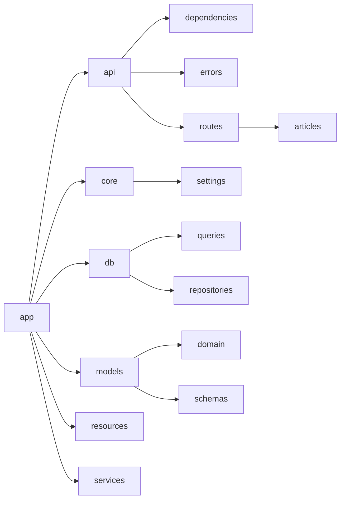

# Architecture Overview

The application is a FastAPI service whose source code lives entirely within the `app` top-level package, which is intentionally empty at the root level and distributes all behaviour across seven focused submodules [[target/app]]. The entry point is `main.py`, which defines and immediately invokes a `get_application` factory to produce the module-level ASGI application instance; that factory wires together every other layer in order — reading settings, configuring logging, constructing the `FastAPI` instance, attaching CORS middleware, registering lifecycle hooks, mounting error handlers, and finally attaching the top-level router under the path prefix declared in settings [[target/app]].

The foundational infrastructure is owned by the `core` package, which provides configuration resolution, a logging bridge, and lifecycle event handlers [[target/app/core]]. Configuration is resolved once through a cached factory, `get_app_settings`, that maps the active `AppEnvTypes` variant — `dev`, `prod`, or `test` — to the corresponding concrete settings class and returns it as a shared `AppSettings` instance [[target/app/core/settings]]. That shared class exposes a `fastapi_kwargs` property for the framework constructor and a `configure_logging` method that routes standard-library log records through `InterceptHandler` into Loguru [[target/app/core/settings]]. The three environment-specific subclasses tailor that base: `DevAppSettings` enables debug mode and reads from `.env`, `ProdAppSettings` redirects to `prod.env`, and `TestAppSettings` substitutes deterministic hardcoded values so test runs carry no dependency on real infrastructure [[target/app/core/settings]]. Application lifecycle is managed by two factory functions, `create_start_app_handler` and `create_stop_app_handler`, which produce the async coroutines FastAPI registers for startup and shutdown; together they bracket the request-serving period by calling into the database layer to open and close the connection pool [[target/app/core]].

All database connectivity and data access are owned by the `db` package [[target/app/db]]. The `events` module creates an `asyncpg` connection pool at startup and stores it on `app.state`, then closes it cleanly at shutdown [[target/app/db]]. The `queries` sub-package is the sole definition and execution layer for SQL: `tables.py` exposes five pypika table singletons — `Users`, `Articles`, `Tags`, `ArticlesToTags`, and `Favorites` — along with a `Parameter` wrapper that emits asyncpg's `$n` positional placeholder syntax, and `queries.py` loads all `.sql` files via `aiosql` at import time into a single `queries` object that is the exclusive entry point for database operations [[target/app/db/queries]]. The repositories sub-package builds on top of those primitives, with every class inheriting connection management from `BaseRepository`, raising the sentinel `EntityDoesNotExist` on failed lookups, and assembling domain objects in private hydration helpers [[target/app/db/repositories]]. `UsersRepository` covers the full user-record lifecycle, hashing passwords before any SQL is issued and wrapping partial updates in atomic transactions [[target/app/db/repositories]]. `ProfilesRepository` constructs an internal `UsersRepository` on the same connection to resolve user records without a separate connection and conditionally populates the `following` boolean only when a requesting user is present [[target/app/db/repositories]]. `ArticlesRepository` is the most complex, composing both a `ProfilesRepository` and a `TagsRepository` on the same shared connection, supporting dynamic query construction via pypika for filtered reads, and funnelling every raw database record through a private hydration helper [[target/app/db/repositories]]. `CommentsRepository` follows the same pattern, holding an internal `ProfilesRepository` for author resolution and channelling every row through a private helper before returning a fully hydrated `Comment` [[target/app/db/repositories]]. Across the entire package, SQL lives in the `queries` module, connection management is inherited from `BaseRepository`, and repositories compose one another on a shared connection rather than managing independent sessions [[target/app/db/repositories]].

The `models` package defines every data shape the application works with, divided across shared mixins, a domain layer, and a schemas layer [[target/app/models]]. Two mixins in `common.py` are composed freely wherever needed: `DateTimeModelMixin` adds auto-populated `created_at` and `updated_at` timestamps, and `IDModelMixin` contributes an integer identity field aliased to `"id"` for JSON deserialisation [[target/app/models]]. The domain sub-package's root is `RWModel`, a Pydantic `BaseModel` subclass that registers a camelCase alias generator for all fields and a `Z`-suffixed ISO 8601 encoder for `datetime` values [[target/app/models/domain]]. All core entities inherit from it: `Profile` carries the public-facing view of a user, `User` holds application-facing account fields, and `UserInDB` extends `User` with database identity, timestamps, and the `change_password` and `check_password` methods that are the sole site for password hashing and verification [[target/app/models/domain]]. `Article` and `Comment` each compose `IDModelMixin`, `DateTimeModelMixin`, and `RWModel`, with both embedding `Profile` as the shared sub-model for author information [[target/app/models/domain]]. The schemas sub-package forms the API boundary, with `RWSchema` extending `RWModel` by adding `orm_mode = True` so schemas can be hydrated directly from database row objects [[target/app/models/schemas]]. Article schemas cover paginated listing filters, creation, partial updates, and both single and collection response envelopes; comment and user schemas follow the same envelope pattern at their respective scales; and `JWTMeta` and `JWTUser` separate generic token claims from application-specific user identity within a JWT payload [[target/app/models/schemas]].

Business logic that belongs neither in a route handler nor in a repository is isolated in the `services` package [[target/app/services]]. JWT creation and decoding are handled by a pair of functions: `create_access_token_for_user` serialises a `User` domain object into a signed token, and `get_username_from_token` inverts that operation, re-raising any cryptographic or schema failure as a `ValueError` [[target/app/services]]. Password operations are centralised around a shared `passlib` `CryptContext` configured for `bcrypt`, with `generate_salt`, `get_password_hash`, and `verify_password` each carrying no side effects or exceptions [[target/app/services]]. Ownership checks for articles and comments compare author usernames against the requesting user and return a plain boolean, while uniqueness pre-checks for usernames and emails query the repository and translate `EntityDoesNotExist` into a `False` return rather than propagating it [[target/app/services]].

The HTTP surface is provided by the `api` package, which groups request wiring, error formatting, and routing into three sub-packages [[target/app/api]]. The `dependencies` sub-package translates raw HTTP inputs into typed domain objects: a `get_repository` factory supplies per-request connections borrowed from the application pool, the authentication module decodes JWTs and resolves `User` records on top of those connections, and three resource modules for articles, comments, and profiles each compose both to produce fully resolved domain objects with access control already enforced — converting missing-entity signals into `404 Not Found` responses and authorisation failures into `403 Forbidden` responses [[target/app/api/dependencies]]. The `errors` sub-package intercepts every `HTTPException` and every validation failure and wraps them in a uniform `"errors"` envelope; the validation handler also patches the generated OpenAPI schema so that documentation accurately reflects the `422` response shape [[target/app/api/errors]]. The `routes` sub-package organises all endpoints into feature-specific modules assembled under one mountable router: authentication endpoints mint JWTs on registration and login; user endpoints retrieve and update the current caller's account; profile endpoints expose follow and unfollow operations with guards against self-following and redundant state changes; the articles sub-package covers paginated listing, CRUD, feed, and favouriting with authorisation enforced by route-level dependencies; comment endpoints support listing, creation, and ownership-gated deletion; and the tags endpoint delegates entirely to its repository and returns the full tag list with no additional logic [[target/app/api/routes]].

Finally, the `resources` package acts as a single registry of every string constant the API may return to a client, covering entity lookup results, ownership errors, authentication failures, and social-graph constraint violations, so that any part of the codebase reporting a problem to a caller imports a named constant rather than embedding text inline [[target/app/resources]].

## Packages

### app

The `app` package is the top-level namespace for the entire FastAPI service, and its [`__init__.py`](target/app/__init__.py) is intentionally empty, existing solely to make the directory importable as a Python package [[target/app/__init__.py]]. All behaviour is distributed across seven submodules that each own a distinct layer of the application [[target/app]].

The entry point is [`main.py`](target/app/main.py), which defines the `get_application` factory and immediately invokes it to produce the module-level `app` instance that an ASGI server such as Uvicorn targets [[target/app/main.py]]. That factory wires together every other layer in sequence: it reads settings, configures logging, constructs the `FastAPI` instance, attaches CORS middleware, registers startup and shutdown lifecycle hooks, mounts the exception handlers for HTTP errors and validation failures, and finally attaches the top-level router under the path prefix declared in settings [[target/app/main.py::get_application]].

The foundational infrastructure lives in the `core` package, which provides the configuration resolution, logging bridge, and lifecycle event handlers on which the rest of the application depends [[target/app/core]]. Settings are resolved once through a cached factory that maps the active `AppEnvTypes` variant to the appropriate concrete class — development, production, or test — and that class exposes both a `fastapi_kwargs` property for the constructor and a `configure_logging` method that routes standard-library records through `InterceptHandler` into Loguru [[target/app/core/config.py::get_app_settings]]. The startup and shutdown handlers produced by `create_start_app_handler` and `create_stop_app_handler` bracket the entire request-serving period by calling into the database layer to open and close the connection pool [[target/app/core/events.py::create_start_app_handler]] [[target/app/core/events.py::create_stop_app_handler]].

Database connectivity and all data access are owned by the `db` package [[target/app/db]]. The `events` module manages an `asyncpg` pool stored on `app.state`, creating it at startup and tearing it down cleanly at shutdown [[target/app/db/events.py::connect_to_db]] [[target/app/db/events.py::close_db_connection]]. The `queries` sub-package anchors every SQL statement: `tables.py` exposes five pypika table singletons and a `Parameter` wrapper that emits asyncpg's `$n` placeholder syntax, while `queries.py` loads all `.sql` files via `aiosql` at import time into a single `queries` object that is the sole entry point for database operations [[target/app/db/queries/tables.py::TypedTable]] [[target/app/db/queries/queries.py]]. The repositories sub-package builds on top of those primitives: all five repository classes inherit connection management from `BaseRepository`, raise the sentinel `EntityDoesNotExist` on failed lookups, assemble domain objects in private hydration helpers, and compose one another on a shared connection rather than managing independent sessions [[target/app/db/repositories/base.py::BaseRepository]] [[target/app/db/repositories/articles.py::ArticlesRepository]] [[target/app/db/errors.py::EntityDoesNotExist]].

The `models` package defines every data shape the application works with, divided across three sub-packages [[target/app/models]]. Domain entities — `RWModel`, `User`, `UserInDB`, `Profile`, `Article`, and `Comment` — form the internal representation of the system's core objects, with `RWModel` providing camelCase aliasing and ISO 8601 datetime encoding for all descendants [[target/app/models/domain/rwmodel.py::RWModel]] [[target/app/models/domain/users.py::UserInDB]]. Schema types form the API boundary, validating incoming request bodies and serialising outgoing responses for every resource, with `RWSchema` adding ORM-mode hydration to the hierarchy [[target/app/models/schemas/rwschema.py::RWSchema]] [[target/app/models/schemas/articles.py::ArticleForResponse]] [[target/app/models/schemas/users.py::UserWithToken]]. The shared mixins `DateTimeModelMixin` and `IDModelMixin` are composed freely into both layers wherever timestamps or integer identity are needed [[target/app/models/common.py::DateTimeModelMixin]] [[target/app/models/common.py::IDModelMixin]].

Business logic that does not belong in a route handler or a repository is isolated in the `services` package [[target/app/services]]. JWT creation and decoding, password hashing and verification, slug generation, ownership checks for articles and comments, and uniqueness pre-checks for usernames and emails are each handled by small, focused functions with no route decorators or framework dependencies [[target/app/services/jwt.py::create_access_token_for_user]] [[target/app/services/jwt.py::get_username_from_token]] [[target/app/services/security.py]] [[target/app/services/articles.py::check_user_can_modify_article]] [[target/app/services/authentication.py::check_username_is_taken]] [[target/app/services/authentication.py::check_email_is_taken]].

The HTTP surface is provided by the `api` package, which groups request wiring, error formatting, and routing into three sub-packages [[target/app/api]]. The `dependencies` sub-package translates headers, path parameters, and application state into typed domain objects that route handlers can declare directly, converting missing-entity signals into `404` responses and authorisation failures into `403` responses [[target/app/api/dependencies]]. The `errors` sub-package intercepts every `HTTPException` and validation failure and wraps them in a uniform `"errors"` envelope, also patching the OpenAPI schema so documentation matches the actual response shape [[target/app/api/errors/http_error.py]] [[target/app/api/errors/validation_error.py]]. The `routes` sub-package organises all endpoints into feature-specific modules assembled under one mountable router, covering authentication, user account management, profiles with follow and unfollow, articles with CRUD, pagination, feed, and favouriting, comment listing and ownership-gated deletion, and tag listing [[target/app/api/routes/api.py]] [[target/app/api/routes/authentication.py::register]] [[target/app/api/routes/profiles.py::follow_for_user]] [[target/app/api/routes/articles/articles_resource.py]] [[target/app/api/routes/comments.py::delete_comment_from_article]] [[target/app/api/routes/tags.py::get_all_tags]].

Finally, the `resources` package acts as a single registry of every string constant the API may return to a client, covering entity lookup results, ownership errors, authentication failures, and social-graph constraint violations, so that any part of the codebase reporting a problem to a caller imports a named constant rather than embedding text inline [[target/app/resources/strings.py]].

### api

The `api` package is the outermost HTTP layer of the application, grouping everything needed to receive requests, authenticate callers, resolve domain objects, enforce permissions, and return well-formed responses into four focused sub-packages [[target/app/api]]. Its own [`__init__.py`](target/app/api/__init__.py) contains no code and exists solely to mark the directory as a Python package [[target/app/api/__init__.py]].

The [`dependencies`](target/app/api/dependencies) sub-package forms the request-wiring layer, translating raw HTTP inputs — headers, path parameters, query strings, and application state — into typed domain objects that route handlers can declare directly [[target/app/api/dependencies]]. It is organised as a hierarchy: the database module supplies per-request async connections borrowed from a shared pool, the authentication module decodes JWTs and resolves `User` records on top of those connections, and three resource modules — for articles, comments, and profiles — each compose both to produce fully resolved domain objects with access control already enforced, converting any missing-entity signal into a `404 Not Found` response and any authorisation failure into a `403 Forbidden` response [[target/app/api/dependencies]].

The [`errors`](target/app/api/errors) sub-package is responsible for intercepting failures and formatting them uniformly before they reach the client [[target/app/api/errors]]. One handler catches every `HTTPException` and wraps its detail inside a list under a single `"errors"` key, and a second handler applies the same envelope to every validation failure, always returning HTTP 422 and additionally patching the generated OpenAPI schema so that documentation accurately reflects the response shape [[target/app/api/errors/http_error.py]] [[target/app/api/errors/validation_error.py]].

The [`routes`](target/app/api/routes) sub-package is the complete HTTP routing layer, organised as feature-specific modules assembled into one mountable router [[target/app/api/routes]]. A top-level [`api.py`](target/app/api/routes/api.py) registers sub-routers for authentication, the current user, profiles, tags, comments, and articles, each under its own URL prefix and OpenAPI tag [[target/app/api/routes/api.py]]. Authentication endpoints mint JWTs on registration and login; user endpoints retrieve and update the current caller's account; profile endpoints expose follow and unfollow operations with guards against self-following and redundant state changes; the articles sub-package covers paginated listing, CRUD, feed, and favouriting; comment endpoints support listing, creation, and ownership-gated deletion; and the tags endpoint delegates entirely to its repository and returns the full tag list with no additional logic [[target/app/api/routes/authentication.py::register]] [[target/app/api/routes/authentication.py::login]] [[target/app/api/routes/users.py::update_current_user]] [[target/app/api/routes/profiles.py::follow_for_user]] [[target/app/api/routes/profiles.py::unsubscribe_from_user]] [[target/app/api/routes/articles/articles_resource.py]] [[target/app/api/routes/articles/articles_common.py::mark_article_as_favorite]] [[target/app/api/routes/comments.py::delete_comment_from_article]] [[target/app/api/routes/tags.py::get_all_tags]].

### dependencies

The `dependencies` package is a collection of FastAPI dependency modules that together form the complete request-wiring layer for the API, translating raw HTTP inputs — headers, path parameters, query strings, and application state — into typed domain objects that route handlers can declare and receive without repeating lookup or validation logic inline [[target/app/api/dependencies]]. The package itself exposes no symbols of its own; its `__init__.py` is intentionally empty, acting purely as a namespace anchor [[target/app/api/dependencies/__init__.py]].

Database access is the foundation on which all other dependencies rest. [`get_repository`](target/app/api/dependencies/database.py) is a factory that accepts a `BaseRepository` subclass and returns a dependency callable wired to a live connection; beneath it, a per-request async generator borrows a `Connection` from the shared application-level `Pool` and releases it automatically once the request finishes, so every repository-consuming dependency in the package inherits clean connection lifecycle management without knowing the details [[target/app/api/dependencies/database.py]] [[target/app/api/dependencies/database.py::get_repository]].

Authentication sits one layer above the database and is entirely self-contained in its own module. The public entry point is `get_current_user_authorizer`, a factory that returns either a required or an optional user-resolution dependency depending on the `required` flag passed by the caller [[target/app/api/dependencies/authentication.py::get_current_user_authorizer]]. Internally, it selects between two header-extraction paths — one that raises on a missing token and one that returns an empty string — before decoding the JWT and fetching the matching `User` record; both a malformed token and an unknown username are deliberately collapsed into the same `403 Forbidden` response to avoid leaking which step failed [[target/app/api/dependencies/authentication.py::_get_current_user]].

The three resource-specific modules each follow the same compositional pattern: a lookup dependency that resolves an entity from the URL and an optional `User`, and a permission dependency that builds on the lookup to enforce write access. In the articles module, [`get_article_by_slug_from_path`](target/app/api/dependencies/articles.py) resolves an `Article` from the path slug and passes the optional caller through to the repository so that per-user state such as favourite status is included; [`check_article_modification_permissions`](target/app/api/dependencies/articles.py) then composes on top of it, requiring a fully authenticated user and raising `403 Forbidden` if authorship cannot be confirmed [[target/app/api/dependencies/articles.py::get_article_by_slug_from_path]] [[target/app/api/dependencies/articles.py::check_article_modification_permissions]]. A third dependency in that module, [`get_articles_filters`](target/app/api/dependencies/articles.py), stands apart from the lookup chain entirely: it bundles validated query-string parameters into a single `ArticlesFilters` object for use by listing routes [[target/app/api/dependencies/articles.py::get_articles_filters]].

The comments module mirrors this structure exactly. [`get_comment_by_id_from_path`](target/app/api/dependencies/comments.py) resolves a `Comment` from the numeric path parameter, delegates the parent-article lookup to the articles dependency, and accepts unauthenticated callers; [`check_comment_modification_permissions`](target/app/api/dependencies/comments.py) injects the resolved comment and a required authenticated user, raising `403 Forbidden` when the permission helper rejects the request [[target/app/api/dependencies/comments.py::get_comment_by_id_from_path]] [[target/app/api/dependencies/comments.py::check_comment_modification_permissions]]. In all cases where a requested entity does not exist, both modules catch `EntityDoesNotExist` from the repository and re-raise it as an `HTTPException` with `404 Not Found`, ensuring database-layer signals are always translated into well-formed HTTP responses [[target/app/api/dependencies/articles.py::get_article_by_slug_from_path]] [[target/app/api/dependencies/comments.py::get_comment_by_id_from_path]].

The profiles module is the simplest of the three: it provides a single async dependency, [`get_profile_by_username_from_path`](target/app/api/dependencies/profiles.py), that resolves a `Profile` from a URL username, forwards the optional requesting user to the repository so the result can be personalised (for example, to reflect follow status), and converts any missing-record signal into a `404 Not Found` response [[target/app/api/dependencies/profiles.py::get_profile_by_username_from_path]]. Taken together, the five modules form a coherent hierarchy: the database module supplies connections, the authentication module supplies users, and the three resource modules compose both to supply fully resolved domain objects with access control already enforced [[target/app/api/dependencies]].

### errors

The `errors` package is a dedicated namespace within `app.api` whose sole responsibility is to intercept and uniformly format error responses before they reach the client [[target/app/api/errors]]. Its [`__init__.py`](target/app/api/errors/__init__.py) contains no code of its own; it exists purely to mark the directory as a Python package and make its sibling modules importable under the `app.api.errors` namespace [[target/app/api/errors/__init__.py]].

The two substantive modules each handle a distinct class of failure. [`http_error.py`](target/app/api/errors/http_error.py) intercepts any `HTTPException` raised anywhere in the application and converts it into a `JSONResponse` whose body places `exc.detail` inside a list under a single `"errors"` key, with the HTTP status code taken directly from `exc.status_code` [[target/app/api/errors/http_error.py::http_error_handler]]. This design enforces a consistent error envelope across all HTTP error responses rather than leaving each call site to format its own reply [[target/app/api/errors/http_error.py]]. [`validation_error.py`](target/app/api/errors/validation_error.py) mirrors that contract for the 422 case: its `http422_error_handler` calls `exc.errors()` on either a `RequestValidationError` or a `ValidationError`, wraps the resulting list under the same `"errors"` key, and always returns HTTP 422 so that clients receive validation feedback in a machine-readable format [[target/app/api/errors/validation_error.py::http422_error_handler]]. In addition to the runtime handler, the module patches `validation_error_response_definition` at import time so that the generated OpenAPI documentation accurately reflects the shape of the 422 response body [[target/app/api/errors/validation_error.py]].

Taken together, the two handlers are intended to be registered at the framework level, ensuring that every unhandled `HTTPException` and every validation failure is automatically routed through a single, shared formatting point [[target/app/api/errors/http_error.py]] [[target/app/api/errors/validation_error.py]].

### routes

The `routes` package is the complete HTTP routing layer of the application, organised as a collection of feature-specific sub-modules that are assembled into a single mountable router [[target/app/api/routes]]. Its [`__init__.py`](target/app/api/routes/__init__.py) is intentionally empty, serving only as the Python package marker that makes the directory importable [[target/app/api/routes/__init__.py]].

The assembly point for the entire layer is [`api.py`](target/app/api/routes/api.py), which creates one top-level `APIRouter` and registers every feature sub-router onto it via `include_router`, each under its own URL prefix and OpenAPI grouping tag [[target/app/api/routes/api.py]]. The sub-routers it wires together cover authentication at `/users`, the current user at `/user`, profiles at `/profiles`, tags at `/tags`, comments at `/articles/{slug}/comments`, and articles without an additional prefix [[target/app/api/routes/api.py]].

Authentication is handled by [`authentication.py`](target/app/api/routes/authentication.py), which exposes `POST ""` for registration and `POST /login` for login; both endpoints run uniqueness or credential checks before persisting or verifying data, mint a JWT through `jwt.create_access_token_for_user`, and return a `UserInResponse` wrapping a `UserWithToken` so a caller receives a ready-to-use token from either operation [[target/app/api/routes/authentication.py::login]] [[target/app/api/routes/authentication.py::register]].

The current user's account is managed by [`users.py`](target/app/api/routes/users.py), whose two handlers both require an authenticated caller and both return a freshly minted token alongside the user's profile fields [[target/app/api/routes/users.py]]. `retrieve_current_user` simply wraps the resolved user in a `UserInResponse`, while `update_current_user` first enforces username and email uniqueness guards before delegating the write to `UsersRepository` and producing the same response shape [[target/app/api/routes/users.py::retrieve_current_user]] [[target/app/api/routes/users.py::update_current_user]].

Profile following and unfollowing are the responsibility of [`profiles.py`](target/app/api/routes/profiles.py). Reading a profile via `GET /{username}` is a pass-through handler whose only line of logic wraps the dependency-resolved `Profile` in a `ProfileInResponse` [[target/app/api/routes/profiles.py::retrieve_profile_by_username]]. The follow and unfollow handlers are mirror images that both guard against self-following and against redundant state changes before calling `ProfilesRepository` and returning the envelope with the `following` field patched to reflect the outcome [[target/app/api/routes/profiles.py::follow_for_user]] [[target/app/api/routes/profiles.py::unsubscribe_from_user]].

All article endpoints live in the [`articles`](target/app/api/routes/articles) sub-package, which exposes its own `api.py` as a single import that mounts two sibling modules under `/articles` [[target/app/api/routes/articles/api.py]]. The core CRUD surface in [`articles_resource.py`](target/app/api/routes/articles/articles_resource.py) covers paginated listing, creation with slug-uniqueness enforcement, slug-based retrieval, and update and delete operations whose authorisation is enforced by a shared route-level dependency before the handler body runs [[target/app/api/routes/articles/articles_resource.py]]. Feed and favouriting features are provided by [`articles_common.py`](target/app/api/routes/articles/articles_common.py), where the feed handler delegates entirely to `ArticlesRepository` and the two favouriting handlers are mirror images that persist or remove the relationship, guard against duplicates and spurious removals with HTTP 400, and return `ArticleInResponse` with `favorited` and `favorites_count` updated accordingly [[target/app/api/routes/articles/articles_common.py::mark_article_as_favorite]] [[target/app/api/routes/articles/articles_common.py::remove_article_from_favorites]].

Comment operations are the domain of [`comments.py`](target/app/api/routes/comments.py), which defines handlers for listing, creating, and deleting comments on a given article [[target/app/api/routes/comments.py]]. Listing accepts both anonymous and authenticated callers, creation requires authentication and responds with HTTP 201, and deletion enforces ownership through a route-level `check_comment_modification_permissions` dependency and returns HTTP 204 with an empty body; all three delegate their data access entirely to an injected `CommentsRepository` [[target/app/api/routes/comments.py::list_comments_for_article]] [[target/app/api/routes/comments.py::create_comment_for_article]] [[target/app/api/routes/comments.py::delete_comment_from_article]].

Finally, [`tags.py`](target/app/api/routes/tags.py) is the simplest module in the package, exposing a single `GET` handler that injects a `TagsRepository`, delegates to its `get_all_tags()` method, and wraps the result in a `TagsInList` response with no additional logic [[target/app/api/routes/tags.py::get_all_tags]].

### articles

The `articles` package is the self-contained routing layer for all article-related HTTP endpoints in the application, organised across three substantive modules and a package initialiser [[target/app/api/routes/articles]]. The `__init__.py` file is intentionally empty, existing only to mark the directory as a Python package [[target/app/api/routes/articles/__init__.py]].

The assembly point for the entire package is [`api.py`](target/app/api/routes/articles/api.py), which creates a single `APIRouter` and mounts the routers from both sibling modules under the `/articles` prefix, giving higher-level application wiring a single import to register every article endpoint at once [[target/app/api/routes/articles/api.py]].

The first of those two sibling modules, [`articles_resource.py`](target/app/api/routes/articles/articles_resource.py), owns the core CRUD surface of the articles API [[target/app/api/routes/articles/articles_resource.py]]. It exposes `GET ""` for paginated, optionally filtered article listings — accessible without authentication — and `POST ""` for creating a new article, where a slug is derived from the submitted title and rejected with HTTP 400 if it is already taken [[target/app/api/routes/articles/articles_resource.py::list_articles]] [[target/app/api/routes/articles/articles_resource.py::create_new_article]]. A `GET /{slug}` handler wraps a fully pre-resolved `Article` domain object in an `ArticleInResponse` envelope without performing any database work itself, because the lookup is handled entirely by the `get_article_by_slug_from_path` dependency [[target/app/api/routes/articles/articles_resource.py::retrieve_article_by_slug]]. The `PUT /{slug}` and `DELETE /{slug}` handlers share a `check_article_modification_permissions` route-level dependency that enforces authorisation before their bodies execute, keeping permission logic out of the handler code and consistent across both mutations [[target/app/api/routes/articles/articles_resource.py::update_article_by_slug]] [[target/app/api/routes/articles/articles_resource.py::delete_article_by_slug]].

The second sibling module, [`articles_common.py`](target/app/api/routes/articles/articles_common.py), covers the user feed and favouriting features [[target/app/api/routes/articles/articles_common.py]]. `GET /feed` returns a paginated list of articles tailored to the authenticated caller, delegating the fetch entirely to the `ArticlesRepository` [[target/app/api/routes/articles/articles_common.py::get_articles_for_user_feed]]. `POST /{slug}/favorite` and `DELETE /{slug}/favorite` are mirror-image handlers: the first persists a favouriting relationship and returns an `ArticleInResponse` with `favorited` set to `True` and `favorites_count` incremented, while the second removes it and returns the same envelope with `favorited` set to `False` and the count decremented; both raise HTTP 400 rather than allow a duplicate or a spurious removal [[target/app/api/routes/articles/articles_common.py::mark_article_as_favorite]] [[target/app/api/routes/articles/articles_common.py::remove_article_from_favorites]]. All three handlers in this module share the same structural pattern of depending on `get_current_user_authorizer` for authentication and `get_repository(ArticlesRepository)` for database access, keeping the route logic decoupled from both concerns [[target/app/api/routes/articles/articles_common.py]].

### core

The `core` package is the application's foundational layer, providing the configuration, lifecycle, and logging infrastructure on which the rest of the application depends [[target/app/core]]. Its [`__init__.py`](target/app/core/__init__.py) is intentionally empty, serving only to mark the directory as a Python package so that its submodules are importable by the rest of the application [[target/app/core/__init__.py]].

Configuration resolution is handled by [`config.py`](target/app/core/config.py), which acts as the single entry point for obtaining a settings object [[target/app/core/config.py]]. It maintains an `environments` dictionary that maps each of the three `AppEnvTypes` variants to the corresponding concrete settings class, and its [`get_app_settings()`](target/app/core/config.py) factory function reads the active environment from a baseline `BaseAppSettings` instance, looks up the correct class, and returns it as an `AppSettings` object [[target/app/core/config.py::get_app_settings]]. The `lru_cache` decorator ensures this resolution runs only once, so every caller across the application receives the same consistent instance [[target/app/core/config.py::get_app_settings]].

The concrete settings types themselves live in the [`settings`](target/app/core/settings) subpackage, which organises them into a layered hierarchy [[target/app/core/settings]]. The base of the hierarchy is `BaseAppSettings`, a Pydantic `BaseSettings` subclass that binds every instance to one of the three deployment environments via its `app_env` field [[target/app/core/settings/base.py::BaseAppSettings]]. `AppSettings` extends that base with the full complement of fields needed to start the server — covering application metadata, database connectivity, and security and routing — and adds active behaviour through its `fastapi_kwargs` property, which assembles those fields into the form the FastAPI constructor expects, and its `configure_logging` method, which routes standard-library log records through an `InterceptHandler` into Loguru [[target/app/core/settings/app.py::AppSettings]]. The three environment-specific subclasses each tailor that shared base: `DevAppSettings` enables debug mode and points the loader at `.env` [[target/app/core/settings/development.py::DevAppSettings]], `ProdAppSettings` redirects the loader to `prod.env` and relies on inherited defaults to identify itself as production [[target/app/core/settings/production.py::ProdAppSettings]], and `TestAppSettings` substitutes hardcoded, deterministic values to eliminate any accidental dependency on real infrastructure [[target/app/core/settings/test.py::TestAppSettings]].

The logging bridge lives in [`logging.py`](target/app/core/logging.py), which defines [`InterceptHandler`](target/app/core/logging.py), a minimal subclass of `logging.Handler` that intercepts standard-library log records and forwards them to Loguru [[target/app/core/logging.py::InterceptHandler]]. Its `emit` method resolves each record's level to a Loguru-native name where possible, falls back to the raw numeric level for non-standard levels, walks the call stack past the standard-library intermediary frames so that Loguru attributes the entry to the true originating call site, and finally dispatches with any accompanying exception information [[target/app/core/logging.py::InterceptHandler]].

Application lifecycle is managed by [`events.py`](target/app/core/events.py), which provides two factory functions that produce the async handlers FastAPI registers for startup and shutdown [[target/app/core/events.py]]. `create_start_app_handler` closes over the application instance and the settings object and returns a coroutine that calls `connect_to_db` before the first request is served [[target/app/core/events.py::create_start_app_handler]]. Its counterpart, `create_stop_app_handler`, returns a coroutine decorated with `@logger.catch` that calls `close_db_connection` on shutdown, ensuring that any teardown exception is captured and logged rather than silently lost [[target/app/core/events.py::create_stop_app_handler]]. Together the two functions form a symmetrical connection lifecycle that brackets the entire request-serving period of the application [[target/app/core/events.py::create_start_app_handler]] [[target/app/core/events.py::create_stop_app_handler]].

### settings

The `settings` package is the centralised configuration system for the FastAPI application, organising all environment-specific and shared settings into a layered hierarchy of Pydantic models [[target/app/core/settings]]. Its [`__init__.py`](target/app/core/settings/__init__.py) is an empty file that exists solely to register the directory as a Python package, making the `app.core.settings` namespace resolvable [[target/app/core/settings/__init__.py]].

The foundation is laid in [`base.py`](target/app/core/settings/base.py), which defines two tightly coupled types [[target/app/core/settings/base.py]]. `AppEnvTypes` is a plain Python `Enum` that enumerates the three valid deployment environments — `prod`, `dev`, and `test` — acting as a controlled vocabulary rather than a settings model [[target/app/core/settings/base.py::AppEnvTypes]]. `BaseAppSettings` extends Pydantic's `BaseSettings` and declares a single field, `app_env`, typed as `AppEnvTypes` and defaulting to `AppEnvTypes.prod`, so that every concrete settings instance is bound to one of those three environments and can draw its values from environment variables or a `.env` file [[target/app/core/settings/base.py::BaseAppSettings]].

Building on that foundation, [`app.py`](target/app/core/settings/app.py) defines `AppSettings`, which extends `BaseAppSettings` with the full set of fields the server needs to start [[target/app/core/settings/app.py::AppSettings]]. Fields are grouped by concern: seven describe the FastAPI application itself (including `title`, `version`, and `debug`), three govern database connectivity (`database_url`, `max_connection_count`, and `min_connection_count`), and four handle security and routing (`secret_key`, `api_prefix`, `jwt_token_prefix`, and `allowed_hosts`) [[target/app/core/settings/app.py::AppSettings]]. Its inner `Config` class sets `validate_assignment = True`, so Pydantic re-validates any field that is reassigned after construction, preventing silent misconfiguration [[target/app/core/settings/app.py::AppSettings]]. Beyond passive data storage, `AppSettings` actively participates in bootstrapping: the `fastapi_kwargs` property assembles the application metadata fields into the exact keyword-argument form expected by the FastAPI constructor, and the `configure_logging` method wires standard-library log records through an `InterceptHandler` into Loguru, registering `sys.stderr` as the sole sink at the configured level [[target/app/core/settings/app.py::AppSettings]].

The three remaining modules each extend `AppSettings` for a specific deployment context. `DevAppSettings` in [`development.py`](target/app/core/settings/development.py) enables debug mode, raises `logging_level` to `logging.DEBUG`, adjusts the application title, and directs the environment file loader to read from `.env` [[target/app/core/settings/development.py::DevAppSettings]]. `ProdAppSettings` in [`production.py`](target/app/core/settings/production.py) introduces no new fields and overrides only its inner `Config` class to redirect the loader to `prod.env`, with `app_env` inherited as `AppEnvTypes.prod` so any environment-branching logic unambiguously identifies it as production [[target/app/core/settings/production.py::ProdAppSettings]]. `TestAppSettings` in [`test.py`](target/app/core/settings/test.py) substitutes safe, deterministic values for test runs: debug is enabled, `secret_key` is hardcoded as `SecretStr("test_secret")`, both connection-pool bounds are fixed at `5`, and `database_url` is left without a default so it must be supplied explicitly at instantiation time, removing any accidental dependency on real infrastructure [[target/app/core/settings/test.py::TestAppSettings]].

### db

The `app.db` package is the complete database layer of the application, encompassing connection lifecycle management, query definition, and all data-access logic under a single importable namespace [[target/app/db]]. Its presence as a Python package is established by an empty [`__init__.py`](target/app/db/__init__.py) that contains no definitions, imports, or logic of its own, but marks the directory so that every submodule within it is reachable as part of `app.db` [[target/app/db/__init__.py]].

Connection lifecycle is the responsibility of [`events.py`](target/app/db/events.py), which defines exactly two async functions intended to bracket the application's lifetime [[target/app/db/events.py]]. At startup, `connect_to_db` calls `asyncpg.create_pool` with connection-count bounds drawn from application settings and stores the resulting pool on `app.state.pool`, making it available to the rest of the application for as long as the process runs [[target/app/db/events.py::connect_to_db]]. At shutdown, the symmetric `close_db_connection` retrieves that same pool and awaits its `close()` method to tear it down cleanly, with both functions emitting `loguru` log messages before and after their core operations so that connection events are visible in the application log [[target/app/db/events.py::close_db_connection]] [[target/app/db/events.py::connect_to_db]].

Lookup failures are communicated through a single custom exception type defined in [`errors.py`](target/app/db/errors.py). `EntityDoesNotExist` inherits directly from Python's built-in `Exception`, adds no extra fields or methods, and exists solely to make missing-entity conditions distinguishable from other error types by catching this specific class [[target/app/db/errors.py::EntityDoesNotExist]].

The [`queries`](target/app/db/queries) sub-package forms the query definition and execution layer, dividing its responsibilities between two substantive modules [[target/app/db/queries]]. [`tables.py`](target/app/db/queries/tables.py) represents the database schema in Python using pypika, anchored by `TypedTable`, a `Table` subclass that resolves a table's name from a `__table__` attribute or falls back to the subclass name, and builds on top of it five module-level singletons — `Users`, `Articles`, `Tags`, `ArticlesToTags`, and `Favorites` — that can be imported directly wherever queries are being composed [[target/app/db/queries/tables.py]] [[target/app/db/queries/tables.py::TypedTable]]. The module also defines `Parameter`, a thin wrapper that rewrites integer indices into asyncpg's `$n` positional placeholder syntax, ensuring driver compatibility [[target/app/db/queries/tables.py::Parameter]]. [`queries.py`](target/app/db/queries/queries.py) then uses `aiosql` to load every SQL file from the adjacent `sql` subdirectory at import time, binding each named query to the asyncpg driver and exposing the result as a single `queries` object that is the sole entry point for all database operations in the application [[target/app/db/queries/queries.py]].

The [`repositories`](target/app/db/repositories) sub-package is the complete data-access tier, grouping every class responsible for reading and writing persistent data into a single namespace [[target/app/db/repositories]]. All repositories inherit from `BaseRepository`, defined in [`base.py`](target/app/db/repositories/base.py), which accepts a live asyncpg connection at construction time, stores it as `_conn`, and exposes it through a `connection` property, so that connection management is handled once rather than repeated across subclasses [[target/app/db/repositories/base.py::BaseRepository]]. `UsersRepository` covers the full user-record lifecycle through four async methods, raising `EntityDoesNotExist` on failed lookups, hashing passwords before any SQL is issued, and re-fetching the authoritative record before applying partial updates inside an atomic transaction [[target/app/db/repositories/users.py::UsersRepository]]. `ProfilesRepository` constructs an internal `UsersRepository` on the same connection to resolve user records without a separate connection, conditionally populates the `following` boolean only when a requesting user is present, and wraps its two write methods in atomic transactions [[target/app/db/repositories/profiles.py::ProfilesRepository]]. `TagsRepository` exposes two methods: one that returns all tags as a flat list of strings, and one that ensures tags exist before articles attempt to link them [[target/app/db/repositories/tags.py::TagsRepository]]. `ArticlesRepository` is the most complex, composing both a `ProfilesRepository` and a `TagsRepository` on the same connection, supporting dynamic query construction via pypika for filtered reads, and funnelling every raw database record through a private hydration helper that assembles a fully populated `Article` domain object [[target/app/db/repositories/articles.py::ArticlesRepository]]. `CommentsRepository` follows the same pattern, holding an internal `ProfilesRepository` for author resolution, channelling every row through a private helper that awaits the author's profile, and offering four public methods for lookup, listing, creation, and deletion without embedding any raw SQL in the repository body [[target/app/db/repositories/comments.py::CommentsRepository]]. Across the entire package the same discipline is enforced: SQL lives in the `queries` module, connection management is inherited from `BaseRepository`, domain objects are assembled in private hydration helpers, and repositories compose one another on a shared connection rather than managing independent sessions [[target/app/db/repositories]] [[target/app/db/repositories/base.py::BaseRepository]] [[target/app/db/repositories/articles.py::ArticlesRepository]].

### queries

The `queries` package forms the complete database query layer for the application, grouping together everything needed to define table structures, compose SQL, and execute named queries against the database [[target/app/db/queries]]. Its presence as an importable namespace is established by an empty [`__init__.py`](target/app/db/queries/__init__.py), which contains no logic of its own but makes the directory referenceable as `app.db.queries` throughout the rest of the project [[target/app/db/queries/__init__.py]].

The package's two substantive modules divide responsibilities cleanly between query definition and query execution. [`tables.py`](target/app/db/queries/tables.py) is responsible for representing the database schema in Python using pypika [[target/app/db/queries/tables.py]]. It introduces `TypedTable`, a pypika `Table` subclass that resolves a table's database name either from a `__table__` class attribute or, as a fallback, from the subclass's own `__name__`, keeping each table declaration concise and declarative [[target/app/db/queries/tables.py::TypedTable]]. Built on top of `TypedTable` are five concrete representations: `Users`, `Articles`, `Tags`, `ArticlesToTags`, and `Favorites`, each declaring the columns relevant to its table and instantiated as module-level singletons so they can be imported directly wherever queries are being constructed [[target/app/db/queries/tables.py]]. The module also defines `Parameter`, a thin wrapper around pypika's `CommonParameter` that rewrites integer indices into asyncpg's positional placeholder syntax (`$1`, `$2`, etc.), ensuring compatibility with asyncpg rather than the `?` or `%s` style used by other drivers [[target/app/db/queries/tables.py::Parameter]].

[`queries.py`](target/app/db/queries/queries.py) then ties query definition to query execution by using `aiosql` to load every SQL file from the `sql` subdirectory alongside the module at import time, binding each named query to the `asyncpg` driver so it becomes a callable Python method [[target/app/db/queries/queries.py]]. The directory is resolved portably via `pathlib.Path(__file__).parent`, meaning the correct path is found regardless of where the process is launched from [[target/app/db/queries/queries.py]]. The single `queries` object produced by this loading step is the sole entry point through which all database operations in the application are executed [[target/app/db/queries/queries.py]].

### repositories

The `repositories` package is the complete database-access tier of the application, grouping every class responsible for reading and writing persistent data into a single importable namespace [[target/app/db/repositories]]. An empty [`__init__.py`](target/app/db/repositories/__init__.py) file contains no definitions of its own but marks the directory as a Python package so that all sibling modules are reachable under the `app.db.repositories` namespace [[target/app/db/repositories/__init__.py]].

The structural foundation shared by every module is established in [`base.py`](target/app/db/repositories/base.py), which defines `BaseRepository` — a plain class whose sole job is to accept a live `asyncpg` connection at construction time, store it as the private `_conn` attribute, and expose it through a `connection` property [[target/app/db/repositories/base.py::BaseRepository]]. Every concrete repository in the package inherits from this class, meaning connection management is handled once and uniformly rather than being repeated in each subclass [[target/app/db/repositories/base.py::BaseRepository]].

User persistence is handled by [`users.py`](target/app/db/repositories/users.py), whose `UsersRepository` covers the full lifecycle of a user record through four async methods: two read methods that raise `EntityDoesNotExist` rather than silently returning `None` when no row is found, a `create_user` method that hashes the password before issuing any SQL and merges server-generated values back into the returned object, and an `update_user` method that re-fetches the authoritative record before applying partial changes inside an atomic transaction [[target/app/db/repositories/users.py::UsersRepository]].

Profile and follow-graph operations live in [`profiles.py`](target/app/db/repositories/profiles.py). `ProfilesRepository` constructs an internal `UsersRepository` on the same connection so it can resolve user records without requiring a second connection from outside, and its primary read method `get_profile_by_username` conditionally populates the `following` boolean only when a requesting user is supplied, skipping that extra query entirely when one is absent [[target/app/db/repositories/profiles.py::ProfilesRepository]]. The two write methods, `add_user_into_followers` and `remove_user_from_followers`, are mirror images of each other that wrap their delegated SQL calls in atomic transactions [[target/app/db/repositories/profiles.py::ProfilesRepository]].

Tag data is managed by the minimal [`tags.py`](target/app/db/repositories/tags.py) module. `TagsRepository` exposes exactly two methods: `get_all_tags`, which returns a flat `List[str]` by extracting the first column of every row the query produces, and `create_tags_that_dont_exist`, which converts each input string into a small dictionary before forwarding the collection to the named query, ensuring tags are available before articles attempt to link them [[target/app/db/repositories/tags.py::TagsRepository]].

The most complex module is [`articles.py`](target/app/db/repositories/articles.py), whose `ArticlesRepository` composes all of the above by constructing both a `ProfilesRepository` and a `TagsRepository` on the same connection at instantiation time [[target/app/db/repositories/articles.py::ArticlesRepository]]. Its write methods cover creation (opening a transaction, inserting the article row, optionally ensuring tags exist, and linking them), updates (deep-copying the domain object before mutating it, then stamping it with the database-returned timestamp), and deletion (a single named-query call scoped by slug and author username) [[target/app/db/repositories/articles.py::ArticlesRepository]]. On the read side, `filter_articles` builds SQL dynamically with pypika to support tag, author, and favourited-by filters, while `get_articles_for_user_feed` retrieves articles from followed accounts with limit/offset pagination [[target/app/db/repositories/articles.py::ArticlesRepository]]. All read paths funnel through the private `_get_article_from_db_record` helper, which awaits the author's profile from `self._profiles_repo`, fetches the tag list and favourite count via sibling repository methods, and conditionally resolves the favourited flag before assembling the final `Article` domain object [[target/app/db/repositories/articles.py::ArticlesRepository]].

Comment operations follow the same structural pattern in [`comments.py`](target/app/db/repositories/comments.py). `CommentsRepository` holds an internal `ProfilesRepository` for author resolution and channels every raw database row through the private `_get_comment_from_db_record` helper, which maps scalar fields and awaits the author's profile before returning a fully hydrated `Comment` [[target/app/db/repositories/comments.py::CommentsRepository]]. The four public methods cover single-comment lookup by ID and slug (raising `EntityDoesNotExist` on a miss), retrieval of all comments for an article, creation, and deletion — all delegating their SQL to the `queries` module and keeping the repository body free of raw SQL [[target/app/db/repositories/comments.py::CommentsRepository]].

Taken together, the package enforces a consistent discipline: SQL lives entirely in the `queries` module, connection management is inherited from `BaseRepository`, domain objects are assembled in private hydration helpers, and each repository composes the others on a shared connection rather than managing independent sessions [[target/app/db/repositories]] [[target/app/db/repositories/base.py::BaseRepository]] [[target/app/db/repositories/articles.py::ArticlesRepository]].

### models

The `models` package is the application's complete data-modelling layer, dividing responsibilities across three sub-packages: a set of reusable mixins, a domain layer holding core entity definitions, and a schemas layer forming the API boundary [[target/app/models]]. The package initialiser contributes nothing of its own, existing solely to make the directory importable as `app.models` [[target/app/models/__init__.py]].

The shared building blocks live in [`common.py`](target/app/models/common.py), which provides two Pydantic mixins designed to be composed freely into any model that needs them [[target/app/models/common.py]]. [`DateTimeModelMixin`](target/app/models/common.py::DateTimeModelMixin) adds `created_at` and `updated_at` timestamp fields, each of which is automatically populated with `datetime.datetime.now()` by a `pre=True` validator whenever no explicit value is supplied [[target/app/models/common.py::DateTimeModelMixin]]. [`IDModelMixin`](target/app/models/common.py::IDModelMixin) contributes a single integer identity field named `id_` in Python but aliased to `"id"` for JSON deserialisation, defaulting to `0` [[target/app/models/common.py::IDModelMixin]].

The `domain` sub-package defines the fundamental entities the system works with [[target/app/models/domain]]. The root of the domain hierarchy is `RWModel`, a Pydantic `BaseModel` subclass that registers a camelCase alias generator for all fields, a `Z`-suffixed ISO 8601 encoder for `datetime` values, and enables population by either the Python field name or its generated alias [[target/app/models/domain/rwmodel.py::RWModel]]. Any subclass that requires an alias other than the auto-generated camelCase form must declare it explicitly [[target/app/models/domain/rwmodel.py::RWModel]]. `Profile` inherits directly from `RWModel` and captures the public-facing view of a user, carrying `username`, `bio`, `image`, and a `following` boolean [[target/app/models/domain/profiles.py::Profile]]. The user layer comes in two levels: `User` holds the four application-facing fields, while `UserInDB` extends it with `IDModelMixin` and `DateTimeModelMixin` and adds `salt` and `hashed_password`; it is also the sole site where passwords are hashed via `change_password` and verified via `check_password` [[target/app/models/domain/users.py::UserInDB]]. `Article` composes `IDModelMixin`, `DateTimeModelMixin`, and `RWModel` to cover identity, timestamps, and serialisation, and declares eight content fields including an embedded `Profile` as its `author` [[target/app/models/domain/articles.py::Article]]. `Comment` follows the same compositional pattern and adds only a `body` string and an `author` typed as `Profile`, making `Profile` the shared sub-model that surfaces author information across both entity types [[target/app/models/domain/comments.py::Comment]] [[target/app/models/domain/articles.py]] [[target/app/models/domain/comments.py]].

The `schemas` sub-package forms the API boundary layer, grouping models that validate incoming requests and serialise outgoing responses for every domain resource [[target/app/models/schemas]]. The common foundation here is `RWSchema`, which inherits from `RWModel` and adds `orm_mode = True`, allowing schemas to be hydrated directly from database row objects [[target/app/models/schemas/rwschema.py::RWSchema]]. Article schemas are the most extensive: `ArticleForResponse` combines `RWSchema` with the domain `Article` and exposes tags under a `"tagList"` alias; `ArticleInResponse` and `ListOfArticlesInResponse` wrap single and multiple articles respectively; `ArticleInCreate` and `ArticleInUpdate` handle creation and partial update inputs; and `ArticlesFilters` governs listing queries with bounded `limit` and `offset` defaults [[target/app/models/schemas/articles.py::ArticleForResponse]] [[target/app/models/schemas/articles.py::ArticleInCreate]] [[target/app/models/schemas/articles.py::ArticleInUpdate]] [[target/app/models/schemas/articles.py::ArticlesFilters]]. Comment schemas follow the same envelope pattern at smaller scale, with `CommentInCreate` accepting a body, and `CommentInResponse` and `ListOfCommentsInResponse` wrapping single and multiple `Comment` objects [[target/app/models/schemas/comments.py::CommentInCreate]] [[target/app/models/schemas/comments.py::CommentInResponse]] [[target/app/models/schemas/comments.py::ListOfCommentsInResponse]]. User schemas cover the full authentication lifecycle: `UserInLogin` carries credentials, `UserInCreate` adds `username` for registration, `UserInUpdate` makes all profile fields optional for PATCH semantics, `UserWithToken` appends a JWT to the domain `User`, and `UserInResponse` wraps the result for the caller [[target/app/models/schemas/users.py::UserInLogin]] [[target/app/models/schemas/users.py::UserInCreate]] [[target/app/models/schemas/users.py::UserInUpdate]] [[target/app/models/schemas/users.py::UserWithToken]] [[target/app/models/schemas/users.py::UserInResponse]]. The remaining schemas are each deliberately minimal: `ProfileInResponse` nests a `Profile` under a `"profile"` key, `TagsInList` wraps a list of tag strings, and the pair of `JWTMeta` and `JWTUser` separate generic token claims from application-specific user identity within a JWT payload [[target/app/models/schemas/profiles.py::ProfileInResponse]] [[target/app/models/schemas/tags.py::TagsInList]] [[target/app/models/schemas/jwt.py::JWTMeta]] [[target/app/models/schemas/jwt.py::JWTUser]].

### domain

The `domain` package is the application's core data layer, grouping all Pydantic models that represent the fundamental entities the system works with [[target/app/models/domain]]. Its presence as an importable Python package is established by an empty initialiser that contributes no definitions of its own but makes the directory referenceable under the `app.models.domain` namespace [[target/app/models/domain/__init__.py]].

The foundation on which every other model in the package is built is `RWModel`, defined in [`rwmodel.py`](target/app/models/domain/rwmodel.py) [[target/app/models/domain/rwmodel.py]]. `RWModel` is a Pydantic `BaseModel` subclass that declares no fields itself but configures two formatting conventions for all subclasses: the `convert_field_to_camel_case` function is registered as Pydantic's `alias_generator`, so every snake\_case field name is automatically exposed under its camelCase equivalent on the API boundary, and `convert_datetime_to_realworld` is registered in `json_encoders` so that `datetime.datetime` values are always serialised as `Z`-suffixed ISO 8601 strings rather than `+00:00`-suffixed ones [[target/app/models/domain/rwmodel.py::RWModel]]. The `Config` also enables `allow_population_by_field_name`, meaning instances can be constructed with either the Python field name or the generated alias [[target/app/models/domain/rwmodel.py::RWModel]]. Because the alias generator runs for every field automatically, any subclass that requires a different alias must declare it explicitly to override the generated one [[target/app/models/domain/rwmodel.py::RWModel]].

The `Profile` model, in [`profiles.py`](target/app/models/domain/profiles.py), is the simplest domain entity that inherits directly from `RWModel` [[target/app/models/domain/profiles.py]]. It captures the public-facing view of a user as seen by others, declaring `username` as a required string, `bio` as a string defaulting to an empty value, `image` as an optional string defaulting to `None`, and `following` as a boolean defaulting to `False` that records whether the currently authenticated user is following this profile [[target/app/models/domain/profiles.py::Profile]].

The user models in [`users.py`](target/app/models/domain/users.py) come in two layers [[target/app/models/domain/users.py]]. `User` inherits from `RWModel` and holds the four fields appropriate for general application use: required `username` and `email` strings, a `bio` string defaulting to an empty string, and an optional `image` field [[target/app/models/domain/users.py::User]]. `UserInDB` extends `User` with `IDModelMixin` and `DateTimeModelMixin` to gain a database `id_` integer and `created_at`/`updated_at` timestamps, and adds `salt` and `hashed_password` string fields that are deliberately absent from the plain `User` model [[target/app/models/domain/users.py::UserInDB]]. `UserInDB` is the sole site in the codebase where raw passwords are turned into stored credentials via `change_password`, which generates a fresh salt and hashes the concatenation of that salt and the supplied plaintext, and where stored credentials are verified via `check_password`, which prepends the stored salt before delegating to `security.verify_password` [[target/app/models/domain/users.py::UserInDB]].

The `Article` model in [`articles.py`](target/app/models/domain/articles.py) represents a complete article object and composes identity, timestamps, and core content by inheriting from `IDModelMixin`, `DateTimeModelMixin`, and `RWModel` [[target/app/models/domain/articles.py::Article]]. Its own eight fields cover `slug`, `title`, `description`, `body`, a list of `tags`, an `author` typed as `Profile`, a `favorited` boolean, and a `favorites_count` integer [[target/app/models/domain/articles.py::Article]]. Because `id_` carries its own explicit `"id"` alias, it is not affected by the camelCase alias generator that governs the remaining fields [[target/app/models/domain/articles.py::Article]].

The `Comment` model in [`comments.py`](target/app/models/domain/comments.py) follows the same compositional pattern as `Article`, inheriting from `IDModelMixin`, `DateTimeModelMixin`, and `RWModel` to acquire identity, timestamps, and camelCase serialisation [[target/app/models/domain/comments.py::Comment]]. It contributes only two fields of its own: `body`, a string holding the comment text, and `author`, typed as `Profile`, identifying who wrote it [[target/app/models/domain/comments.py::Comment]]. Together, `Article` and `Comment` both embed `Profile` as a nested object, making `Profile` the shared sub-model that surfaces author information throughout the domain layer [[target/app/models/domain/articles.py]] [[target/app/models/domain/comments.py]].

### schemas

The `schemas` package is the API boundary layer for the application, grouping all Pydantic models that validate incoming request data and serialise outgoing response data across every domain resource [[target/app/models/schemas]]. Its presence as a Python package is established by an empty [`__init__.py`](target/app/models/schemas/__init__.py), which adds nothing of its own but makes each sibling module importable under the `app.models.schemas` namespace [[target/app/models/schemas/__init__.py]].

The shared foundation for most schemas in the package is [`RWSchema`](target/app/models/schemas/rwschema.py), defined in [`rwschema.py`](target/app/models/schemas/rwschema.py). It inherits from the domain-level `RWModel` — which provides camelCase field aliasing and consistent serialisation conventions — and extends it with a single inner `Config` that sets `orm_mode = True`, allowing Pydantic to populate these models directly from ORM row objects rather than requiring plain dictionaries [[target/app/models/schemas/rwschema.py::RWSchema]]. Every schema that needs to be hydrated from database results inherits from `RWSchema` rather than from `BaseModel` directly [[target/app/models/schemas/rwschema.py]].

The most fully developed submodule is [`articles.py`](target/app/models/schemas/articles.py), which covers every article-related data shape the API handles [[target/app/models/schemas/articles.py]]. The shared response payload is `ArticleForResponse`, which combines `RWSchema` with the domain `Article` model through multiple inheritance and adds only a `tags` field exposed as `"tagList"` [[target/app/models/schemas/articles.py::ArticleForResponse]]. Single-article responses are wrapped by `ArticleInResponse`, while `ListOfArticlesInResponse` carries a collection of `ArticleForResponse` objects alongside an `articles_count` integer [[target/app/models/schemas/articles.py::ArticleInResponse]] [[target/app/models/schemas/articles.py::ListOfArticlesInResponse]]. On the input side, `ArticleInCreate` requires `title`, `description`, and `body` with an optional `"tagList"`, and `ArticleInUpdate` makes all three body fields optional to support PATCH-style partial edits [[target/app/models/schemas/articles.py::ArticleInCreate]] [[target/app/models/schemas/articles.py::ArticleInUpdate]]. Listing queries are governed by `ArticlesFilters`, which inherits from `BaseModel` rather than `RWSchema` and enforces minimum bounds on `limit` and `offset`, using the module-level constants `DEFAULT_ARTICLES_LIMIT` (20) and `DEFAULT_ARTICLES_OFFSET` (0) as defaults [[target/app/models/schemas/articles.py::ArticlesFilters]].

Comment schemas in [`comments.py`](target/app/models/schemas/comments.py) follow the same envelope pattern on a smaller scale [[target/app/models/schemas/comments.py]]. `CommentInCreate` carries only a `body: str` for the creation payload, `CommentInResponse` wraps a single `Comment` domain object, and `ListOfCommentsInResponse` wraps a list of them — all three inheriting from `RWSchema` for consistent aliasing and ORM compatibility [[target/app/models/schemas/comments.py::CommentInCreate]] [[target/app/models/schemas/comments.py::CommentInResponse]] [[target/app/models/schemas/comments.py::ListOfCommentsInResponse]].

User-facing schemas in [`users.py`](target/app/models/schemas/users.py) cover authentication, registration, updates, and responses [[target/app/models/schemas/users.py]]. `UserInLogin` supplies the two credential fields `email` and `password`, and `UserInCreate` extends it by adding `username` for registration [[target/app/models/schemas/users.py::UserInLogin]] [[target/app/models/schemas/users.py::UserInCreate]]. For partial profile edits, `UserInUpdate` inherits from `BaseModel` directly and declares all five of its fields as `Optional`, supporting PATCH semantics [[target/app/models/schemas/users.py::UserInUpdate]]. After a successful authentication, `UserWithToken` extends the domain `User` class with a required `token` field, and the outermost `UserInResponse` wraps that combined object under a `user` key for the caller [[target/app/models/schemas/users.py::UserWithToken]] [[target/app/models/schemas/users.py::UserInResponse]].

The remaining three submodules are each intentionally minimal. [`profiles.py`](target/app/models/schemas/profiles.py) contains only `ProfileInResponse`, a thin `BaseModel` envelope that nests a `Profile` domain object under a `"profile"` key to match the API's structured response convention [[target/app/models/schemas/profiles.py::ProfileInResponse]]. [`tags.py`](target/app/models/schemas/tags.py) provides `TagsInList`, which holds a single `tags: List[str]` field and nothing else, making it a purpose-built schema for serialising tag name collections [[target/app/models/schemas/tags.py::TagsInList]]. Finally, [`jwt.py`](target/app/models/schemas/jwt.py) defines two lightweight `BaseModel` subclasses — `JWTMeta`, carrying the standard `exp` and `sub` claims, and `JWTUser`, carrying a single `username` — that together separate generic token metadata from application-specific user identity within a JWT payload [[target/app/models/schemas/jwt.py::JWTMeta]] [[target/app/models/schemas/jwt.py::JWTUser]].

### resources

The `resources` package is a small, focused collection that centralises human-readable content for the application [[target/app/resources]]. Its [`__init__.py`](target/app/resources/__init__.py) contains no logic whatsoever — it exists solely to mark the directory as an importable Python package [[target/app/resources/__init__.py]].

All substantive content lives in [`strings.py`](target/app/resources/strings.py), which acts as a single registry of string constants covering every error message and status phrase the API may need to return to a client [[target/app/resources/strings.py]]. The constants are organised around four concerns: confirming whether a user, article, or comment can be found; enforcing ownership rules before allowing mutations to an article; reporting authentication and account problems such as bad credentials, duplicate usernames or emails, and malformed or unrecognised tokens; and policing social-graph constraints such as self-follows, redundant follow or unfollow attempts, and duplicate favourites [[target/app/resources/strings.py]]. By keeping every message phrase in one place, any part of the codebase that must report a problem to a caller can import the relevant constant rather than embedding the text inline, which ensures consistent wording across the entire API [[target/app/resources/strings.py]].

### services

The `services` package is the business-logic layer of the application, sitting between the HTTP routes and the data-access repositories and containing no route registrations or framework decorators of its own [[target/app/services]]. Its presence as a package is established by an empty initialiser file that contributes no definitions but makes all sibling modules importable under the `app.services` namespace [[target/app/services/__init__.py]].

Article-related logic is handled by [`articles.py`](target/app/services/articles.py), which provides three focused utilities [[target/app/services/articles.py]]. `check_article_exists` is an async helper that queries an `ArticlesRepository` by slug and translates an `EntityDoesNotExist` exception into a `False` return value rather than propagating it [[target/app/services/articles.py::check_article_exists]]. `get_slug_for_article` is a pure synchronous function that converts a plain title into a URL-friendly slug by delegating entirely to `slugify`, carrying no side effects [[target/app/services/articles.py::get_slug_for_article]]. `check_user_can_modify_article` enforces ownership by comparing the article's author username with the requesting user's username, returning `True` only when they match [[target/app/services/articles.py::check_user_can_modify_article]].

User-registration uniqueness checks live in [`authentication.py`](target/app/services/authentication.py), which exposes two closely parallel async functions [[target/app/services/authentication.py]]. `check_username_is_taken` queries the repository via `get_user_by_username` and returns `False` if `EntityDoesNotExist` is raised, `True` otherwise [[target/app/services/authentication.py::check_username_is_taken]]. `check_email_is_taken` follows the identical pattern but targets the email field through `get_user_by_email` [[target/app/services/authentication.py::check_email_is_taken]]. The two functions are designed to be called before a new account is persisted, not to perform the persistence themselves [[target/app/services/authentication.py]].

Comment ownership is handled by the single function `check_user_can_modify_comment` in [`comments.py`](target/app/services/comments.py), which compares the username stored on a comment's author against the supplied user's username and returns a plain boolean with no side effects or raised exceptions [[target/app/services/comments.py::check_user_can_modify_comment]].

JWT lifecycle management is the responsibility of [`jwt.py`](target/app/services/jwt.py), which fixes the token type, signing algorithm, and a one-week expiry lifetime in three module-level constants [[target/app/services/jwt.py]]. The low-level primitive `create_jwt_token` merges standard `exp` and `sub` claims into a copy of the caller's payload before encoding it, never mutating the original dictionary [[target/app/services/jwt.py::create_jwt_token]]. `create_access_token_for_user` is the application-facing entry point that serialises a `User` domain object into a `JWTUser` payload and delegates to `create_jwt_token` [[target/app/services/jwt.py::create_access_token_for_user]]. The inverse operation, `get_username_from_token`, decodes a raw token and returns the embedded username as a string, re-raising any cryptographic failure as a `ValueError` with the message `"unable to decode JWT token"` and any schema mismatch as a `ValueError` with the message `"malformed payload in token"` [[target/app/services/jwt.py::get_username_from_token]].

Password security is centralised in [`security.py`](target/app/services/security.py), which constructs a shared `passlib` `CryptContext` configured for `bcrypt` that all three of its functions delegate to [[target/app/services/security.py]]. `generate_salt` produces a fresh cryptographic salt and returns it as a plain UTF-8 string [[target/app/services/security.py::generate_salt]]. `get_password_hash` passes a plain-text password directly to `pwd_context.hash` and returns the result [[target/app/services/security.py::get_password_hash]], while `verify_password` accepts both a plain and a hashed password and returns a boolean match result via `pwd_context.verify`, with none of the three functions carrying decorators, raising exceptions, or producing side effects [[target/app/services/security.py::verify_password]] [[target/app/services/security.py]].

