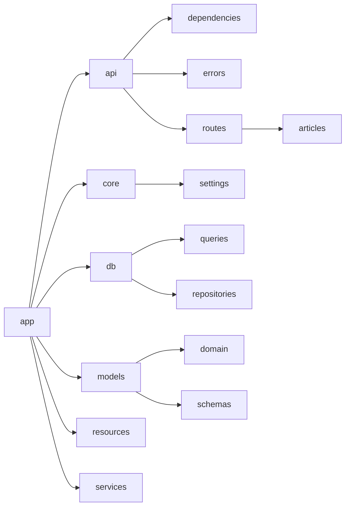

# Architecture Overview

The application is a FastAPI-based web service organised into seven focused sub-packages that together form a single deployable unit [[target/app]]. Assembly begins in `main.py`, which produces a module-level ASGI-ready application instance by calling a factory that retrieves settings, configures logging, attaches CORS middleware, registers lifecycle handlers, mounts centralised exception handlers, and connects the API router under the settings-driven URL prefix [[target/app]].

The operational backbone lives in the `core` package, which bundles configuration management, lifecycle event wiring, and log handling [[target/app/core]]. Configuration is resolved once per process by `get_app_settings`, which selects among `DevAppSettings`, `ProdAppSettings`, and `TestAppSettings` based on the active environment and caches the result via `@lru_cache` [[target/app/core]]. These three leaf classes share a common contract defined in `AppSettings`, which requires `database_url` and `secret_key` to be explicitly supplied and exposes a `configure_logging` method [[target/app/core/settings]]. Startup and shutdown hooks delegate directly to the database layer for connection pool creation and teardown [[target/app/core]]. Log unification is achieved through `InterceptHandler`, a `logging.Handler` subclass that bridges the standard-library logging system into Loguru so all log traffic from the root logger and Uvicorn loggers flows through a single consistent sink [[target/app/core]].

The `db` package is the complete database layer, providing connection lifecycle management, error signalling, raw query execution, and domain-level data access [[target/app/db]]. `connect_to_db` creates an asyncpg pool at startup and stores it on `app.state.pool`, while `close_db_connection` tears it down cleanly on exit [[target/app/db]]. The single exception class `EntityDoesNotExist` is raised whenever a requested record cannot be found, serving as the canonical signal for missing data throughout the codebase [[target/app/db]]. The `queries` subpackage parses all SQL files with `aiosql` into a single shared object and supplies pypika table singletons — `Users`, `Articles`, `Tags`, `ArticlesToTags`, and `Favorites` — with a custom `Parameter` subclass that emits `$n` placeholders matching asyncpg's positional syntax [[target/app/db/queries]]. On top of those primitives, the `repositories` subpackage exposes `UsersRepository`, `ProfilesRepository`, `TagsRepository`, `ArticlesRepository`, and `CommentsRepository`, all inheriting from `BaseRepository`, which accepts an asyncpg connection at construction time and stores it as `_conn` [[target/app/db/repositories]]. `ArticlesRepository` is the most structurally complex, holding internal references to both `ProfilesRepository` and `TagsRepository`, executing all write operations inside transactions, and assembling full domain objects through a private helper that issues additional async calls for author profiles, tags, favourite counts, and per-user favourited state [[target/app/db/repositories]].

The `models` package is the data-modelling layer, divided into shared primitives, canonical domain entities, and API-boundary validation schemas [[target/app/models]]. The foundation is `common.py`, which provides `DateTimeModelMixin` and `IDModelMixin` as composable bases that attach automatic timestamps and a safely defaulting integer identity to any inheriting type [[target/app/models]]. The `domain` sub-package defines `Profile`, `Article`, `Comment`, `User`, and `UserInDB` on top of `RWModel`, which provides automatic camelCase aliasing and ISO 8601 datetime serialisation throughout [[target/app/models/domain]]. The user entity is intentionally split: `User` holds the four application-layer fields with no credentials, while `UserInDB` adds `salt` and `hashed_password` together with `change_password` and `check_password` methods so raw passwords are never compared or stored directly [[target/app/models/domain]]. The `schemas` sub-package forms the HTTP boundary, using `RWSchema` with `orm_mode = True` to cover request validation and response envelopes for users, articles, comments, profiles, and tags, with schemas such as `ArticlesFilters`, `ListOfArticlesInResponse`, and `UserInResponse` giving each domain area a distinct set of inbound and outbound types [[target/app/models/schemas]].

The `services` package carries the business-logic layer, keeping it free of direct HTTP or database concerns [[target/app/services]]. Registration uniqueness is checked by `check_username_is_taken` and `check_email_is_taken`, which translate `EntityDoesNotExist` into plain boolean results [[target/app/services]]. Article ownership and existence are enforced by `check_user_can_modify_article` and `check_article_exists`, while comment ownership is handled by the parallel `check_user_can_modify_comment` [[target/app/services]]. JWT creation and decoding are centralised in `jwt.py`, which anchors all tokens to the `HS256` algorithm and a one-week lifetime and surfaces two distinct `ValueError` failure modes for invalid and malformed tokens [[target/app/services]]. Password operations — salt generation, hashing, and verification — are concentrated in `security.py` behind a single bcrypt-backed `CryptContext` [[target/app/services]].

The `api` package assembles the entire HTTP surface by combining routing, dependency injection, and error handling [[target/app/api]]. Error handling is centralised so that HTTP exceptions and validation failures both reach the client as a uniform JSON envelope keyed on `"errors"`, with `http_error_handler` covering HTTP exceptions and `http422_error_handler` covering both FastAPI-level and Pydantic-level validation failures [[target/app/api/errors]]. The `dependencies` sub-package provides a `get_repository` factory that acquires a connection from the application-level pool and releases it automatically after the request scope exits, and a `get_current_user_authorizer` factory that yields either a strict dependency rejecting unauthenticated requests with `403 Forbidden` or a lenient one returning `None` for anonymous callers [[target/app/api/dependencies]]. Resource resolution follows the same declarative pattern across articles, comments, and profiles, where path parameters are translated into domain objects or `404 Not Found` responses, and ownership violations raise `403 Forbidden`, keeping individual route handlers free of repetitive boilerplate [[target/app/api/dependencies]]. Six sub-routers mounted by the routes assembly point cover authentication under `/users`, the current user under `/user`, social profiles under `/profiles`, the full article CRUD surface plus feed and favourites nested under `/articles`, comments nested under `/articles/{slug}/comments`, and a public tags endpoint under `/tags` [[target/app/api/routes]].

Finally, the `resources` package acts as a centralised registry of plain string constants for every user-facing error and status message in the API — covering authentication failures, duplicate usernames and emails, ownership errors, follow-state conflicts, token validation failures, favouriting errors, and a general authentication-required notice — so that wording can be updated without touching any business logic [[target/app/resources]].

## Packages

### app

The `app` package is the root of the FastAPI web service, and its empty initialiser exists solely to make the directory importable as a Python namespace [[target/app/__init__.py]]. Everything the application does is organised across seven focused sub-packages that the entry point wires together into a single deployable unit [[target/app]].

Assembly begins in [`main.py`](target/app/main.py), which defines and immediately calls `get_application` to produce a module-level `app` instance ready for an ASGI server [[target/app/main.py]]. That factory retrieves settings, configures logging, attaches CORS middleware, registers startup and shutdown lifecycle handlers, mounts the two centralised exception handlers, and finally connects the API router under the settings-driven URL prefix before returning [[target/app/main.py::get_application]].

The operational infrastructure that `main.py` depends on lives in the `core` package, which bundles configuration management, lifecycle event wiring, and log handling [[target/app/core]]. Configuration is resolved once per process by `get_app_settings`, which selects among `DevAppSettings`, `ProdAppSettings`, and `TestAppSettings` based on the active environment and caches the result via `@lru_cache` [[target/app/core]]. Startup and shutdown hooks produced by `create_start_app_handler` and `create_stop_app_handler` delegate to the database layer for pool creation and teardown [[target/app/core]]. All log traffic from the root logger and Uvicorn loggers is unified through `InterceptHandler`, which bridges the standard-library logging system into Loguru so the entire application writes to a single consistent sink [[target/app/core]].

The `db` package is the complete database layer, providing connection lifecycle management, error signalling, raw query execution, and domain-level data access [[target/app/db]]. `connect_to_db` creates an asyncpg pool at startup and stores it on `app.state.pool`, while `close_db_connection` tears it down cleanly on exit [[target/app/db]]. The single exception class `EntityDoesNotExist` is raised whenever a requested record cannot be found, and the rest of the codebase treats it as the canonical signal for missing data [[target/app/db]]. The `queries` subpackage parses all SQL files with `aiosql` into a shared object and supplies pypika table singletons with asyncpg-compatible `$n` placeholders for dynamic query construction [[target/app/db]]. On top of those primitives the `repositories` subpackage exposes `UsersRepository`, `ProfilesRepository`, `TagsRepository`, `ArticlesRepository`, and `CommentsRepository`, each accepting a connection at construction time and returning fully hydrated domain objects to their callers [[target/app/db]].

The `models` package is the data-modelling layer, divided into shared primitives, canonical domain entities, and API-boundary validation schemas [[target/app/models]]. `DateTimeModelMixin` and `IDModelMixin` in `common.py` are composable bases that attach automatic timestamps and a safely defaulting integer identity to any type that inherits them [[target/app/models]]. The `domain` sub-package defines `Profile`, `Article`, `Comment`, `User`, and `UserInDB` on top of `RWModel`, which provides camelCase aliasing and ISO 8601 serialisation throughout [[target/app/models]]. The `schemas` sub-package forms the HTTP boundary, using `RWSchema` with `orm_mode = True` to cover request validation and response envelopes for users, articles, comments, profiles, and tags [[target/app/models]].

The `services` package carries the business-logic layer, keeping it free of direct HTTP or database concerns [[target/app/services]]. Registration uniqueness is checked by `check_username_is_taken` and `check_email_is_taken`, which translate `EntityDoesNotExist` into plain boolean results [[target/app/services]]. Article ownership and existence are enforced by `check_user_can_modify_article` and `check_article_exists`, while comment ownership is handled by the parallel `check_user_can_modify_comment` [[target/app/services]]. JWT creation and decoding are centralised in `jwt.py`, which surfaces two distinct `ValueError` failure modes for invalid and malformed tokens [[target/app/services]]. Password operations ? salt generation, hashing, and verification ? are concentrated in `security.py` behind a single bcrypt-backed `CryptContext` [[target/app/services]].

The `api` package assembles the entire HTTP surface by combining routing, dependency injection, and error handling [[target/app/api]]. The `dependencies` sub-package provides a `get_repository` factory for connection-scoped database access and an `get_current_user_authorizer` factory that yields either a strict or a lenient authentication dependency, alongside per-domain helpers that resolve articles, comments, and profiles from path parameters or return `404` and `403` responses [[target/app/api]]. Error handling is centralised so that HTTP exceptions and validation failures both reach the client as a uniform JSON envelope keyed on `"errors"` [[target/app/api]]. Six sub-routers mounted by `routes/api.py` cover authentication under `/users`, the current user under `/user`, social profiles under `/profiles`, the full article CRUD surface plus feed and favourites, comments nested under `/articles/{slug}/comments`, and a public tags endpoint under `/tags` [[target/app/api]].

Finally, the `resources` package acts as a centralised registry of plain string constants for every user-facing error and status message in the API, so that wording can be updated without touching any business logic [[target/app/resources]].

### api

The `api` package is the top-level assembly of the application's entire HTTP surface, grouping the routing layer, the shared dependency-injection infrastructure, and the centralised error-handling components into a single cohesive unit [[target/app/api]]. Its initialiser contains no code of its own and exists purely to make the package importable [[target/app/api/__init__.py]].

Error handling is centralised in the `errors` sub-package, which ensures that every failure the application raises reaches the client in a uniform JSON envelope [[target/app/api/errors]]. HTTP exceptions are intercepted and wrapped in a response body carrying a single `"errors"` key [[target/app/api/errors/http_error.py::http_error_handler]], while validation failures from both FastAPI and Pydantic are caught separately and returned with status `422`, using the same envelope shape so that clients can handle all error cases uniformly [[target/app/api/errors/validation_error.py::http422_error_handler]].

The shared dependency-injection infrastructure lives in the `dependencies` sub-package, which defines once the logic that all route handlers consume declaratively [[target/app/api/dependencies]]. Database access is provided through a single `get_repository` factory that acquires a connection from the application-level asyncpg pool and releases it automatically after the request scope exits [[target/app/api/dependencies/database.py]]. Authentication is centralised so that route handlers express their requirement with a single `Depends` call, obtaining either a strict dependency that rejects unauthenticated requests with `403 Forbidden` or a lenient one that returns `None` for anonymous callers [[target/app/api/dependencies/authentication.py::get_current_user_authorizer]]. Resource resolution follows the same pattern across three domain modules: articles, comments, and profiles are each looked up from path parameters, translated into `404 Not Found` responses when missing, and guarded by permission checks that raise `403 Forbidden` when the caller does not own the resource [[target/app/api/dependencies/articles.py]] [[target/app/api/dependencies/comments.py::get_comment_by_id_from_path]] [[target/app/api/dependencies/comments.py::check_comment_modification_permissions]] [[target/app/api/dependencies/profiles.py::get_profile_by_username_from_path]].

All HTTP endpoints are wired together in the `routes` sub-package, whose `api.py` assembly point creates a root router and mounts six sub-routers onto it under distinct URL prefixes [[target/app/api/routes/api.py]]. Authentication endpoints handle login and registration under `/users`, both returning a `UserInResponse` containing a freshly minted JWT [[target/app/api/routes/authentication.py::login]] [[target/app/api/routes/authentication.py::register]]. The logged-in user's own resource is served under `/user`, with every successful read or update issuing a new token so the response always reflects the current account state [[target/app/api/routes/users.py::retrieve_current_user]] [[target/app/api/routes/users.py::update_current_user]]. Social profile features are mounted under `/profiles`, where follow and unfollow handlers mirror each other and both enforce a self-referential guard as well as idempotency checks that reject requests when the desired follow state already matches reality [[target/app/api/routes/profiles.py::follow_for_user]] [[target/app/api/routes/profiles.py::unsubscribe_from_user]]. Article endpoints are encapsulated in a dedicated nested sub-package covering the full CRUD surface plus a personalised feed and favourite management, with mutation handlers enforcing ownership through route-level dependencies [[target/app/api/routes/articles]] [[target/app/api/routes/articles/articles_resource.py::update_article_by_slug]] [[target/app/api/routes/articles/articles_common.py::mark_article_as_favorite]]. Comment endpoints nest under `/articles/{slug}/comments` and provide listing, creation, and deletion, where listing tolerates anonymous callers while deletion requires the caller to own the comment [[target/app/api/routes/comments.py::list_comments_for_article]] [[target/app/api/routes/comments.py::delete_comment_from_article]]. Finally, a single publicly accessible tag endpoint under `/tags` returns all known tags with no authentication required [[target/app/api/routes/tags.py::get_all_tags]].

### dependencies

The `dependencies` package is the shared dependency-injection layer for the FastAPI application, grouping all reusable `Depends`-based functions that route handlers across the API rely on for authentication, database access, and resource resolution [[target/app/api/dependencies]]. Its `__init__.py` contains no definitions of its own, but its presence makes all the components defined in the submodules importable as a cohesive unit [[target/app/api/dependencies/__init__.py]].

Database connectivity is provided by [`database.py`](target/app/api/dependencies/database.py), which exposes a three-step chain: the application-level asyncpg pool is read from `request.app.state.pool`, a single connection is acquired from that pool and automatically released after the request scope exits, and the public factory `get_repository` wraps both steps so that any route handler can declare a specific repository class through a single `Depends(get_repository(SomeRepository))` expression [[target/app/api/dependencies/database.py]].

Authentication is centralised in [`authentication.py`](target/app/api/dependencies/authentication.py), which extracts JWT bearer tokens from the `Authorization` header, validates their prefix and payload, and resolves the caller to a `User` record from the database [[target/app/api/dependencies/authentication.py]]. The public entry point is `get_current_user_authorizer`, a factory that route handlers call with a `required` flag to obtain either a strict dependency that rejects unauthenticated requests with `403 Forbidden` or an optional one that returns `None` for anonymous callers, giving each endpoint a single declarative way to express its authentication requirement [[target/app/api/dependencies/authentication.py::get_current_user_authorizer]].

Resource resolution is split across three domain-specific modules. [`articles.py`](target/app/api/dependencies/articles.py) supplies `get_articles_filters` for packaging query-string filter parameters into a typed `ArticlesFilters` object, `get_article_by_slug_from_path` for resolving a URL slug into an `Article` (converting a missing record into a `404 Not Found` HTTP response), and `check_article_modification_permissions` for enforcing author-only write access by raising `403 Forbidden` when the authenticated user is not the article's author [[target/app/api/dependencies/articles.py]]. [`comments.py`](target/app/api/dependencies/comments.py) mirrors this pattern with `get_comment_by_id_from_path`, which resolves a comment scoped to its parent article and converts `EntityDoesNotExist` into a `404`, and `check_comment_modification_permissions`, which builds on top of that resolver to enforce write-access control, forming a dependency chain so that any route requiring modification permissions automatically inherits comment resolution and 404 handling [[target/app/api/dependencies/comments.py::check_comment_modification_permissions]] [[target/app/api/dependencies/comments.py::get_comment_by_id_from_path]]. [`profiles.py`](target/app/api/dependencies/profiles.py) follows the same approach with its single export `get_profile_by_username_from_path`, which resolves a username from the URL path into a `Profile` object, forwarding the optional requesting user to the repository so that viewer-relative state such as follow relationships is included in the result, and translating a missing profile into a `404 Not Found` response [[target/app/api/dependencies/profiles.py::get_profile_by_username_from_path]].

Taken together, the package ensures that authentication, connection management, and per-resource lookup and authorisation logic are defined once and composed declaratively, keeping individual route handlers free of repetitive boilerplate [[target/app/api/dependencies]].

### errors

The `errors` package is the centralized error-handling layer for the FastAPI application, grouping the components responsible for converting exceptions into consistent JSON responses [[target/app/api/errors]]. Its `__init__.py` is an empty initializer that simply marks the directory as a Python package [[target/app/api/errors/__init__.py]].

The package contains two handler modules. The first, `http_error.py`, defines the asynchronous `http_error_handler` function, which intercepts any raised `HTTPException` and wraps it in a JSON response whose body carries a single `"errors"` key mapped to a list containing `exc.detail`, with the HTTP status code taken directly from `exc.status_code` [[target/app/api/errors/http_error.py::http_error_handler]]. This ensures that every HTTP error reaching the client arrives in a uniform envelope rather than as a raw or framework-default response [[target/app/api/errors/http_error.py]].

The second module, `validation_error.py`, handles the narrower case of validation failures through its `http422_error_handler` function, which accepts either a `RequestValidationError` or a `ValidationError` so that both FastAPI-level and Pydantic-level failures are covered [[target/app/api/errors/validation_error.py::http422_error_handler]]. It calls `exc.errors()` to extract the structured list of problems and returns a `JSONResponse` with status code `HTTP_422_UNPROCESSABLE_ENTITY`, again placing the error list under an `"errors"` key to match the envelope established by the HTTP error handler [[target/app/api/errors/validation_error.py::http422_error_handler]]. Additionally, the module rewrites the `"properties"` entry of `validation_error_response_definition` at import time so that the auto-generated OpenAPI documentation stays consistent with the actual response shape the handler produces [[target/app/api/errors/validation_error.py]].

### routes

The `routes` package is the complete HTTP routing layer of the application, grouping every endpoint the API exposes into focused submodules that are then unified in one place [[target/app/api/routes]]. Its [`__init__.py`](target/app/api/routes/__init__.py) contains no definitions of its own and exists solely to make the directory importable as a Python package [[target/app/api/routes/__init__.py]].

The assembly point for the entire surface is [`api.py`](target/app/api/routes/api.py), which creates a root `APIRouter` and registers six sub-routers onto it, each bound to a URL prefix and a tag for the generated OpenAPI schema [[target/app/api/routes/api.py]]. Authentication routes are mounted under `/users`, user-management routes under `/user`, and profile routes under `/profiles`; article routes carry no additional prefix, comment routes nest under `/articles/{slug}/comments`, and tag routes sit under `/tags` [[target/app/api/routes/api.py]]. The articles sub-router is drawn from a nested package rather than a flat sibling module, while every other sub-router is imported directly from its own file in this directory [[target/app/api/routes/api.py]].

Authentication is handled by [`authentication.py`](target/app/api/routes/authentication.py), which exposes two POST endpoints for login and registration [[target/app/api/routes/authentication.py]]. The login handler verifies credentials against the `UsersRepository`, raises HTTP 400 on an unknown email or wrong password, and on success returns a `UserInResponse` wrapping a freshly minted JWT [[target/app/api/routes/authentication.py::login]]. The registration handler first checks that neither the requested username nor email is already taken, then creates the record and immediately issues a token so the caller is authenticated from the moment of registration [[target/app/api/routes/authentication.py::register]]. Both handlers accept `UsersRepository` and `AppSettings` via dependency injection and produce the same `UserInResponse` containing a `UserWithToken` [[target/app/api/routes/authentication.py::login]] [[target/app/api/routes/authentication.py::register]].

The [`users.py`](target/app/api/routes/users.py) module serves the logged-in user's own resource, exposing a `GET` handler that returns the current user's profile with a fresh token and a `PUT` handler that updates it [[target/app/api/routes/users.py]]. Before persisting any change, the update handler runs uniqueness guards on both the incoming username and email, raising HTTP 400 if either is already taken by another account [[target/app/api/routes/users.py::update_current_user]]. Both handlers issue a new JWT on every successful request, so the token in the response always reflects the latest state of the user record [[target/app/api/routes/users.py::retrieve_current_user]] [[target/app/api/routes/users.py::update_current_user]].

Profile social features live in [`profiles.py`](target/app/api/routes/profiles.py), which exposes three endpoints for reading a profile, following a user, and unfollowing a user [[target/app/api/routes/profiles.py]]. The follow and unfollow handlers share the same dependency set — a resolved `Profile`, the current authenticated `User`, and a `ProfilesRepository` — and both apply a self-referential guard that rejects requests where the caller and target are the same account [[target/app/api/routes/profiles.py::follow_for_user]] [[target/app/api/routes/profiles.py::unsubscribe_from_user]]. The follow handler additionally raises HTTP 400 if the profile is already being followed, while the unfollow handler raises HTTP 400 if it is not currently followed, making the two mirror images of each other [[target/app/api/routes/profiles.py::follow_for_user]] [[target/app/api/routes/profiles.py::unsubscribe_from_user]].

Article endpoints are encapsulated in the [`articles`](target/app/api/routes/articles) sub-package, which is itself composed of three modules unified by its own `api.py` assembly point [[target/app/api/routes/articles]]. The `articles_resource` module owns the five core CRUD operations — list with filters, create, retrieve, update, and delete — where update and delete additionally enforce an ownership check through a route-level dependency before any mutation is allowed [[target/app/api/routes/articles/articles_resource.py::update_article_by_slug]] [[target/app/api/routes/articles/articles_resource.py::delete_article_by_slug]]. The `articles_common` module covers the authenticated feed endpoint and the favourite/unfavourite pair, with both favourite handlers raising HTTP 400 when the requested state already matches the current one [[target/app/api/routes/articles/articles_common.py::mark_article_as_favorite]] [[target/app/api/routes/articles/articles_common.py::remove_article_from_favorites]].

Comment endpoints are handled by [`comments.py`](target/app/api/routes/comments.py), which defines three handlers for listing, creating, and deleting comments on a specific article [[target/app/api/routes/comments.py]]. Listing accepts anonymous callers while creation requires authentication and returns HTTP 201; deletion requires the caller to own the comment, enforced by a route-level dependency, and returns HTTP 204 with no body [[target/app/api/routes/comments.py::list_comments_for_article]] [[target/app/api/routes/comments.py::create_comment_for_article]] [[target/app/api/routes/comments.py::delete_comment_from_article]]. Across all three handlers, article and comment objects are resolved through path-based dependencies so the handler bodies receive already-resolved domain objects rather than raw path parameters [[target/app/api/routes/comments.py]].

Finally, [`tags.py`](target/app/api/routes/tags.py) exposes a single publicly accessible `GET /api/tags` endpoint that fetches every tag from the data store via an injected `TagsRepository` and returns them wrapped in a `TagsInList` response model, with no authentication required and no exceptions raised within the handler body [[target/app/api/routes/tags.py]] [[target/app/api/routes/tags.py::get_all_tags]].

### articles

The `articles` package is the self-contained routing layer that handles every HTTP endpoint related to articles in the application [[target/app/api/routes/articles]]. Its [`__init__.py`](target/app/api/routes/articles/__init__.py) contains no definitions but marks the directory as an importable Python package, making the submodules available to the rest of the routing hierarchy [[target/app/api/routes/articles/__init__.py]].

The package is divided into three substantive modules whose responsibilities are kept distinct and then unified in one place [[target/app/api/routes/articles/api.py]]. [`api.py`](target/app/api/routes/articles/api.py) acts as the assembly point: it creates a single `APIRouter` and mounts the two sub-routers from `articles_common` and `articles_resource` under the `/articles` URL prefix, so the broader application only needs to register this one combined router [[target/app/api/routes/articles/api.py]].

[`articles_resource.py`](target/app/api/routes/articles/articles_resource.py) owns the five core CRUD operations for articles [[target/app/api/routes/articles/articles_resource.py]]. It handles listing articles with optional tag, author, favourited, limit, and offset filters — with authentication being optional so unauthenticated callers can still browse — as well as creating, retrieving, updating, and deleting individual articles identified by their URL slug [[target/app/api/routes/articles/articles_resource.py::list_articles]] [[target/app/api/routes/articles/articles_resource.py::create_new_article]] [[target/app/api/routes/articles/articles_resource.py::retrieve_article_by_slug]]. Slug-based article resolution is handled by a shared dependency before the handler body runs, so retrieval, update, and delete handlers all receive the already-resolved article object [[target/app/api/routes/articles/articles_resource.py::retrieve_article_by_slug]] [[target/app/api/routes/articles/articles_resource.py::update_article_by_slug]]. The update and delete handlers additionally enforce an authorisation check through a route-level `check_article_modification_permissions` dependency declared in their decorators, ensuring ownership is verified before any mutation occurs [[target/app/api/routes/articles/articles_resource.py::update_article_by_slug]] [[target/app/api/routes/articles/articles_resource.py::delete_article_by_slug]].

[`articles_common.py`](target/app/api/routes/articles/articles_common.py) covers the two remaining cross-cutting concerns: the authenticated user's personalised article feed and the favouriting system [[target/app/api/routes/articles/articles_common.py]]. The `GET /feed` handler returns a paginated list of articles scoped to the current user, with `limit` and `offset` bounds validated by FastAPI's `Query` [[target/app/api/routes/articles/articles_common.py::get_articles_for_user_feed]]. The `POST /{slug}/favorite` and `DELETE /{slug}/favorite` handlers are mirror images of each other: the first persists a favourite relationship and returns the article with `favorited` set to `True` and `favorites_count` incremented in memory, while the second removes the relationship and decrements the count, and both raise an HTTP 400 error if the requested state already matches the current one [[target/app/api/routes/articles/articles_common.py::mark_article_as_favorite]] [[target/app/api/routes/articles/articles_common.py::remove_article_from_favorites]]. All three handlers in this module share the same dependency injection pattern — authentication via `get_current_user_authorizer()` and database access via `get_repository(ArticlesRepository)` — making the module a cohesive set of endpoints built on a common foundation [[target/app/api/routes/articles/articles_common.py]].

### core

The `core` package is the application's operational backbone, bundling configuration management, lifecycle event wiring, and log handling into a cohesive set of modules that the rest of the application depends on at startup [[target/app/core]]. The [`__init__.py`](target/app/core/__init__.py) file contains no definitions of its own; it exists solely to make the `core` namespace importable [[target/app/core/__init__.py]].

Configuration resolution is handled by [`config.py`](target/app/core/config.py), which maintains an `environments` dictionary mapping each `AppEnvTypes` variant — `dev`, `prod`, and `test` — to its corresponding settings class [[target/app/core/config.py]]. The single function it exposes, `get_app_settings`, reads the active environment from `BaseAppSettings`, looks up and instantiates the matching class, and returns the result as an `AppSettings` object [[target/app/core/config.py::get_app_settings]]. Because it is decorated with `@lru_cache`, this resolution happens exactly once per process lifetime, with every subsequent call receiving the same cached instance [[target/app/core/config.py::get_app_settings]].

The settings classes themselves live in the `settings` sub-package, which defines a layered hierarchy of Pydantic models [[target/app/core/settings]]. `BaseAppSettings` reads values from environment variables or a `.env` file and defaults `app_env` to `AppEnvTypes.prod` [[target/app/core/settings]]. Built on top of that, `AppSettings` consolidates every parameter the web server, database, authentication, and logging subsystems require, mandates that `database_url` and `secret_key` be explicitly supplied, and provides a `configure_logging` method that routes all log records through Loguru [[target/app/core/settings]]. The three leaf classes — `DevAppSettings`, `ProdAppSettings`, and `TestAppSettings` — each specialise `AppSettings` with targeted overrides suited to their deployment context without duplicating the shared contract [[target/app/core/settings]].

Database lifecycle management falls to [`events.py`](target/app/core/events.py), which exposes two factory functions that produce the async callables FastAPI registers as its startup and shutdown hooks [[target/app/core/events.py]]. `create_start_app_handler` closes over a `FastAPI` instance and an `AppSettings` object and returns a callable that invokes `connect_to_db` when the application starts [[target/app/core/events.py::create_start_app_handler]]. Its counterpart, `create_stop_app_handler`, returns a callable decorated with `@logger.catch` that calls `close_db_connection` on shutdown, ensuring teardown exceptions are intercepted and logged rather than silently swallowed [[target/app/core/events.py::create_stop_app_handler]].

Log unification is provided by [`logging.py`](target/app/core/logging.py), which defines `InterceptHandler`, a `logging.Handler` subclass whose sole method, `emit`, bridges the standard-library logging system into Loguru [[target/app/core/logging.py::InterceptHandler]]. For each incoming record it resolves the appropriate Loguru level — falling back to the raw integer if the name is unrecognised — walks the call stack past any internal logging frames to identify the true call site, and forwards the event to Loguru with the correct depth and exception info [[target/app/core/logging.py::InterceptHandler]]. This handler is wired up by `AppSettings.configure_logging`, meaning all log traffic from the root logger and the Uvicorn loggers flows through a single, consistent sink from the moment the application is configured [[target/app/core/settings]].

### settings

The `settings` package is the central configuration system for the application, organising every runtime parameter into a layered hierarchy of Pydantic models that can be composed and overridden per deployment environment [[target/app/core/settings]].

The package initialiser marks the directory as a Python package, making all settings submodules importable by the rest of the application [[target/app/core/settings/__init__.py]]. The foundation is laid in [`base.py`](target/app/core/settings/base.py), which defines `AppEnvTypes`, an enum enumerating the three recognised deployment contexts — `prod`, `dev`, and `test` — and `BaseAppSettings`, a Pydantic `BaseSettings` subclass that reads field values from environment variables or a `.env` file and defaults `app_env` to `AppEnvTypes.prod` so the application assumes a production context unless told otherwise [[target/app/core/settings/base.py::AppEnvTypes]] [[target/app/core/settings/base.py::BaseAppSettings]].

Built on top of that foundation, [`app.py`](target/app/core/settings/app.py) defines `AppSettings`, which consolidates every setting the web server, database, authentication, and logging subsystems require into a single Pydantic model [[target/app/core/settings/app.py::AppSettings]]. It requires a `database_url` typed as `PostgresDsn` and a `secret_key` typed as `SecretStr`, meaning the application cannot start without those two values being explicitly supplied [[target/app/core/settings/app.py::AppSettings]]. The `fastapi_kwargs` property packages the seven FastAPI-relevant fields into a plain dictionary ready to be unpacked directly into the FastAPI constructor, and `configure_logging` wires the root logger and each named Uvicorn logger through Loguru's `InterceptHandler` so all log records flow through a single sink [[target/app/core/settings/app.py::AppSettings]]. An inner `Config` class enables `validate_assignment`, ensuring Pydantic enforces type constraints on fields even after the object has been constructed [[target/app/core/settings/app.py::AppSettings]].

The three environment-specific modules each extend `AppSettings` with targeted overrides. `DevAppSettings` enables `debug`, raises `logging_level` to `logging.DEBUG`, retitles the application for development, and reads environment variables from a `.env` file, while inheriting the complete set of database, security, routing, and logging fields unchanged [[target/app/core/settings/development.py::DevAppSettings]]. `ProdAppSettings` inherits all fields without modification and distinguishes itself solely by pointing `env_file` at `prod.env` and carrying the `AppEnvTypes.prod` default on `app_env`, making it the active settings object in production [[target/app/core/settings/production.py::ProdAppSettings]]. `TestAppSettings` overrides `debug`, `title`, `secret_key`, the connection pool limits, and `logging_level` to produce deterministic and self-contained test runs, but still requires `database_url` to be supplied externally via an environment variable rather than hardcoding a default [[target/app/core/settings/test.py::TestAppSettings]].

Taken together, the package provides a single, coherent configuration contract — defined once in `AppSettings` and specialised in each leaf class — so that the application can be started in any of its three known environments simply by selecting the appropriate settings class [[target/app/core/settings/app.py]] [[target/app/core/settings/development.py]] [[target/app/core/settings/production.py]] [[target/app/core/settings/test.py]].

### db

The `db` package is the complete database layer of the application, grouping connection lifecycle management, query definitions, and domain-level data access into a set of focused submodules that together give the rest of the application a coherent interface to PostgreSQL [[target/app/db]]. The [`__init__.py`](target/app/db/__init__.py) contains no logic of its own; it exists solely to mark the directory as a Python package so that its submodules can be imported elsewhere [[target/app/db/__init__.py]].

Connection pool lifecycle is handled by [`events.py`](target/app/db/events.py), which defines two async functions designed to be wired into FastAPI's startup and shutdown hooks [[target/app/db/events.py]]. [`connect_to_db()`](target/app/db/events.py::connect_to_db) takes a `FastAPI` application instance and an `AppSettings` object, calls `asyncpg.create_pool` with the database URL and configured connection counts, and stores the resulting pool on `app.state.pool` for the lifetime of the process [[target/app/db/events.py::connect_to_db]]. [`close_db_connection()`](target/app/db/events.py::close_db_connection) is the symmetric counterpart, awaiting `app.state.pool.close()` to tear the pool down cleanly on exit [[target/app/db/events.py::close_db_connection]]. Both functions emit paired `loguru` log messages before and after their operation so that connection pool activity is always visible in application logs [[target/app/db/events.py::connect_to_db]] [[target/app/db/events.py::close_db_connection]].

Error signalling is centralised in [`errors.py`](target/app/db/errors.py), which defines a single exception class, `EntityDoesNotExist`, inheriting directly from Python's built-in `Exception` [[target/app/db/errors.py]]. Its sole purpose, as declared in its docstring, is to be raised whenever a requested entity cannot be located in the database [[target/app/db/errors.py::EntityDoesNotExist]].

The [`queries`](target/app/db/queries) subpackage provides the raw query execution layer [[target/app/db/queries]]. At import time, `queries.py` uses `aiosql` to parse all SQL files from the adjacent `sql` subdirectory, producing a single shared `queries` object whose attributes correspond directly to named SQL statements; the `asyncpg` adapter is specified during this initialisation so every attribute is immediately compatible with the async connection used throughout the application [[target/app/db/queries]]. Alongside this, `tables.py` supplies typed pypika table references for constructing dynamic queries programmatically, introducing a `Parameter` subclass that emits `$1`, `$2`, etc. placeholders to match asyncpg's positional syntax [[target/app/db/queries]]. Five concrete table classes — `Users`, `Articles`, `Tags`, `ArticlesToTags`, and `Favorites` — are each instantiated once at module level so the rest of the codebase imports those singletons directly rather than constructing new table references on every use [[target/app/db/queries]].

The [`repositories`](target/app/db/repositories) subpackage is the domain-facing data-access layer, organising every database interaction into repository classes built around the application's core domain objects [[target/app/db/repositories]]. All repositories inherit from `BaseRepository`, which accepts an asyncpg `Connection` at construction time, stores it as `_conn`, and exposes it through a read-only `connection` property, giving every subclass a uniform, injection-based path to the database [[target/app/db/repositories]]. `UsersRepository` covers the full user lifecycle through four async methods, raising `EntityDoesNotExist` on failed lookups and hashing passwords before insertion [[target/app/db/repositories]]. `ProfilesRepository` delegates user-level lookups to an internal `UsersRepository` on the same connection while additionally managing the follow graph through transactional insert and delete operations [[target/app/db/repositories]]. `TagsRepository` exposes exactly two methods — one to retrieve all stored tags and one to upsert new ones — by delegating to the shared `queries` object [[target/app/db/repositories]]. `ArticlesRepository` is the most structurally complex, holding internal references to both `ProfilesRepository` and `TagsRepository`, executing all write operations inside transactions, and assembling full `Article` domain objects via a private helper that issues additional async calls for author profiles, tags, favourite counts, and per-user favourited state [[target/app/db/repositories]]. Finally, `CommentsRepository` follows the same pattern, holding an internal `ProfilesRepository` reference and routing all four of its public methods through a private helper that hydrates each `Comment` with a resolved author profile before returning it [[target/app/db/repositories]].

### queries

The `queries` package is the database query layer for the application, providing both a pre-built SQL query executor and a set of typed table references for constructing programmatic queries [[target/app/db/queries]]. The [`__init__.py`](target/app/db/queries/__init__.py) file contains no code of its own, existing only to mark the directory as a Python package [[target/app/db/queries/__init__.py]].

The central query object is assembled in [`queries.py`](target/app/db/queries/queries.py), which uses `aiosql` to parse all SQL files from the adjacent `sql` subdirectory at import time, producing a single shared `queries` object whose attributes correspond to each named SQL statement [[target/app/db/queries/queries.py]]. The `asyncpg` driver adapter is specified during this initialisation, so every query is immediately compatible with the async database connection used throughout the application, and no further registration is needed anywhere else [[target/app/db/queries/queries.py]].

The companion module [`tables.py`](target/app/db/queries/tables.py) handles the programmatic side of database access, defining the pypika table references used to build dynamic queries [[target/app/db/queries/tables.py]]. It introduces a `Parameter` subclass that formats placeholders as `$1`, `$2`, etc., matching the positional syntax expected by `asyncpg` [[target/app/db/queries/tables.py::Parameter]]. On top of that, `TypedTable` extends pypika's `Table` with a `__table__` attribute that lets each subclass resolve its own database table name without requiring construction-time arguments [[target/app/db/queries/tables.py::TypedTable]]. Five concrete table classes are defined — `Users`, `Articles`, `Tags`, `ArticlesToTags`, and `Favorites` — each carrying typed field annotations that mirror their respective database columns [[target/app/db/queries/tables.py::Users]] [[target/app/db/queries/tables.py::Articles]] [[target/app/db/queries/tables.py::Tags]] [[target/app/db/queries/tables.py::ArticlesToTags]] [[target/app/db/queries/tables.py::Favorites]]. Each class is instantiated once at module level, so the rest of the codebase imports these singletons directly rather than constructing new table references on every use [[target/app/db/queries/tables.py]].

### repositories

The `repositories` package is the complete data-access layer of the application, grouping every database interaction into a set of focused repository classes organised around the application's core domain objects [[target/app/db/repositories]]. An empty `__init__.py` marks the directory as a Python package without exposing any symbols of its own [[target/app/db/repositories/__init__.py]].

All domain-specific repositories share a single foundation defined in `base.py`: `BaseRepository` accepts an asyncpg `Connection` at construction time, stores it as `_conn`, and exposes it through a read-only `connection` property, giving every subclass a uniform, injection-based interface to the database without duplicating connection management [[target/app/db/repositories/base.py]].

User records are handled by `UsersRepository`, which inherits from `BaseRepository` and covers the full user lifecycle through four async methods: `get_user_by_email` and `get_user_by_username` raise `EntityDoesNotExist` when no row is found, `create_user` hashes the password before inserting within a transaction, and `update_user` merges optional field overrides onto the current stored state before writing [[target/app/db/repositories/users.py::UsersRepository]].

Profile and follower-graph concerns are separated into `ProfilesRepository`, which constructs an internal `UsersRepository` on the same connection so user-level lookups remain available without duplication [[target/app/db/repositories/profiles.py::ProfilesRepository]]. Its `get_profile_by_username` method assembles a `Profile` from raw user data and optionally resolves the requesting user's follow state via `is_user_following_for_another_user`, while the symmetric pair `add_user_into_followers` and `remove_user_from_followers` mutate the follow graph inside database transactions [[target/app/db/repositories/profiles.py::ProfilesRepository]]. A `UserLike` type alias unioning `User` and `Profile` lets those mutation methods accept either domain type as input [[target/app/db/repositories/profiles.py]].

Tag persistence is the responsibility of `TagsRepository`, which exposes exactly two async methods: `get_all_tags` returns every stored tag as a flat list of strings, and `create_tags_that_dont_exist` upserts any new tags by delegating to the shared `queries` object with one `{"tag": tag}` dictionary per input entry [[target/app/db/repositories/tags.py::TagsRepository]].

The most structurally complex repository is `ArticlesRepository`, which holds internal references to both `ProfilesRepository` and `TagsRepository` on the same connection to avoid redundant connection handling [[target/app/db/repositories/articles.py::ArticlesRepository]]. Write operations — `create_article`, `update_article`, `delete_article`, `add_article_into_favorites`, and `remove_article_from_favorites` — all execute inside transactions, with creation additionally upsert-linking tags through the private `_link_article_with_tags` helper [[target/app/db/repositories/articles.py::ArticlesRepository]]. Read operations include `get_article_by_slug`, which raises `EntityDoesNotExist` on a miss, `filter_articles`, which dynamically builds a pypika query with conditional joins driven by `tag`, `author`, and `favorited` arguments, and `get_articles_for_user_feed`, which scopes results to authors the requesting user follows [[target/app/db/repositories/articles.py::ArticlesRepository]]. All read paths ultimately pass through the private `_get_article_from_db_record` helper, which assembles the full `Article` domain object by issuing additional async calls for the author profile, tags, favourites count, and — when a requesting user is present — per-user favourited status [[target/app/db/repositories/articles.py::ArticlesRepository]].

Comment operations follow the same structural pattern in `CommentsRepository`, which similarly holds an internal `ProfilesRepository` reference because assembling a `Comment` domain object requires resolving the author's profile [[target/app/db/repositories/comments.py::CommentsRepository]]. The four public methods — `get_comment_by_id`, `get_comments_for_article`, `create_comment_for_article`, and `delete_comment` — all delegate final object construction to the private `_get_comment_from_db_record` helper, which reads scalar columns from the raw database record and awaits the profile lookup before returning a hydrated `Comment` [[target/app/db/repositories/comments.py::CommentsRepository]].

### models

The `models` package is the complete data-modelling layer of the application, organised into three cooperating sub-packages that together cover shared primitives, canonical domain entities, and API-boundary validation [[target/app/models]]. The top-level [`__init__.py`](target/app/models/__init__.py) is intentionally empty, acting only as a namespace boundary so that each sub-package can be imported independently by the rest of the application [[target/app/models/__init__.py]].

The foundation for the entire layer is [`common.py`](target/app/models/common.py), which supplies two reusable Pydantic mixins [[target/app/models/common.py]]. `DateTimeModelMixin` attaches `created_at` and `updated_at` timestamp fields whose values are supplied automatically by a pre-validation hook, so any model that inherits from it gains accurate timestamps without extra wiring at the call site [[target/app/models/common.py::DateTimeModelMixin]]. `IDModelMixin` contributes a single integer identity field declared as `id_` in Python but aliased to `"id"` for serialisation, with a safe default of `0` that makes the field readable even before a real database identifier has been assigned [[target/app/models/common.py::IDModelMixin]]. The two mixins are independent and can be composed freely onto any domain or schema type that needs one or both [[target/app/models/common.py::DateTimeModelMixin]] [[target/app/models/common.py::IDModelMixin]].

The `domain` sub-package holds the canonical in-memory representations of the application's core entities [[target/app/models/domain]]. Every domain type ultimately inherits from `RWModel`, which bundles automatic camelCase aliasing, population by Python field name, and ISO 8601 datetime serialisation into a single base class [[target/app/models/domain]]. `Profile` is the simplest entity, carrying only the four publicly visible user fields and serving as an embedded author reference on both articles and comments [[target/app/models/domain]]. `Article` and `Comment` both inherit from `IDModelMixin`, `DateTimeModelMixin`, and `RWModel`, giving them a stable identity and automatic timestamps alongside their own content fields [[target/app/models/domain]]. The user entity is intentionally split: `User` holds the four application-layer fields with no credentials, while `UserInDB` extends it with the two mixin bases and adds `salt` and `hashed_password` fields together with `change_password` and `check_password` methods so that raw passwords are never compared or stored directly [[target/app/models/domain]].

The `schemas` sub-package forms the API boundary layer, grouping all models responsible for validating inbound requests and shaping outbound responses [[target/app/models/schemas]]. Its shared base, `RWSchema`, extends `RWModel` with `orm_mode = True` so that Pydantic can populate schema instances directly from ORM row objects rather than requiring plain dictionaries [[target/app/models/schemas]]. User schemas cover login, registration, partial update, and the token-bearing response envelope; JWT claims are handled separately by `JWTMeta` and `JWTUser` [[target/app/models/schemas]]. Article schemas add module-level pagination constants and provide distinct types for creation, partial update, filtered listing with bounded pagination, and both single and collection responses [[target/app/models/schemas]]. Comment schemas follow the same envelope pattern for creation and both single and list responses [[target/app/models/schemas]]. Profile and tag responses are each handled by a single focused schema — `ProfileInResponse` wrapping the domain `Profile` and `TagsInList` wrapping a `List[str]` — keeping the API surface minimal and consistent throughout [[target/app/models/schemas]].

### domain

The `domain` package is the collection of canonical data models that represent the core entities of the application — articles, comments, profiles, and users — along with the shared base infrastructure that gives them all a consistent shape [[target/app/models/domain]]. The package itself is declared by an empty `__init__.py` that acts purely as a Python package marker, introducing no definitions of its own [[target/app/models/domain/__init__.py]].

All domain models trace their configuration back to [`rwmodel.py`](target/app/models/domain/rwmodel.py), which provides the single base class every other module in the package extends [[target/app/models/domain/rwmodel.py]]. `RWModel` inherits from Pydantic's `BaseModel` and bundles three shared settings: fields can be populated by their Python names as well as their camelCase aliases, `datetime` values are automatically serialised to a compact `Z`-suffixed ISO 8601 string via `convert_datetime_to_realworld`, and every field receives a camelCase alias automatically through `convert_field_to_camel_case` — meaning only fields whose external alias differs from the automatic conversion need an explicit `Field(..., alias="...")` declaration [[target/app/models/domain/rwmodel.py::RWModel]].

The `Profile` model in [`profiles.py`](target/app/models/domain/profiles.py) is the simplest domain type: it inherits only from `RWModel` and carries four fields — `username`, `bio`, `image`, and `following` — describing everything that is publicly visible about a user [[target/app/models/domain/profiles.py::Profile]]. It is used directly as an embedded field on both `Article` and `Comment`, anchoring authorship throughout the model layer [[target/app/models/domain/articles.py::Article]] [[target/app/models/domain/comments.py::Comment]].

`Article`, defined in [`articles.py`](target/app/models/domain/articles.py), is the canonical representation of a full article object [[target/app/models/domain/articles.py]]. It inherits from `IDModelMixin`, `DateTimeModelMixin`, and `RWModel`, so alongside its own nine fields — `slug`, `title`, `description`, `body`, `tags`, `author`, `favorited`, and `favorites_count` — it also carries an integer `id_` aliased to `"id"` and `created_at` / `updated_at` timestamps [[target/app/models/domain/articles.py::Article]].

`Comment`, defined in [`comments.py`](target/app/models/domain/comments.py), follows the same structural pattern: it inherits from the same three bases and owns two fields of its own — `body` for the text content and `author` for the embedded `Profile` of its writer [[target/app/models/domain/comments.py::Comment]].

The user entity is split across two types in [`users.py`](target/app/models/domain/users.py). `User` inherits only from `RWModel` and holds the four application-layer fields — `username`, `email`, `bio`, and `image` — with no identity or credential information [[target/app/models/domain/users.py::User]]. `UserInDB` extends `User` with `IDModelMixin` and `DateTimeModelMixin` and adds `salt` and `hashed_password` fields, making it the complete representation of a stored user row [[target/app/models/domain/users.py::UserInDB]]. Its `change_password` method generates a fresh salt, hashes it together with the supplied plain-text password, and mutates the instance in place, while `check_password` mirrors that process at verification time so the raw password is never compared directly [[target/app/models/domain/users.py::UserInDB]].

### schemas

The `schemas` package is the API boundary layer for the application, grouping all Pydantic models that validate incoming requests and serialise outgoing responses [[target/app/models/schemas]]. Its [`__init__.py`](target/app/models/schemas/__init__.py) is intentionally empty, doing nothing beyond making the directory a proper Python package so that other modules can import from it [[target/app/models/schemas/__init__.py]].

The foundation for nearly every schema in the package is `RWSchema`, defined in [`rwschema.py`](target/app/models/schemas/rwschema.py) [[target/app/models/schemas/rwschema.py]]. It extends `RWModel` and adds a `Config` with `orm_mode = True`, which lets Pydantic populate schema instances directly from ORM row objects rather than requiring plain dictionaries [[target/app/models/schemas/rwschema.py::RWSchema]]. Any schema that needs both the shared aliasing behaviour of `RWModel` and the ability to read ORM results inherits from `RWSchema` [[target/app/models/schemas/rwschema.py::RWSchema]].

User-facing schemas live in [`users.py`](target/app/models/schemas/users.py) [[target/app/models/schemas/users.py]]. `UserInLogin` captures the email and password required to authenticate, and `UserInCreate` extends it with a `username` field to cover new account registration [[target/app/models/schemas/users.py::UserInLogin]] [[target/app/models/schemas/users.py::UserInCreate]]. For partial profile edits, `UserInUpdate` inherits directly from `BaseModel` and makes all five of its fields optional, including `EmailStr`-validated email and `HttpUrl`-validated image [[target/app/models/schemas/users.py::UserInUpdate]]. On the response side, `UserWithToken` appends a `token` field to the domain `User`, and `UserInResponse` wraps it in a single `user` envelope that inherits from `RWSchema` for consistent serialisation [[target/app/models/schemas/users.py::UserWithToken]] [[target/app/models/schemas/users.py::UserInResponse]].

JWT-related data is handled separately in [`jwt.py`](target/app/models/schemas/jwt.py) [[target/app/models/schemas/jwt.py]]. `JWTMeta` holds the standard `exp` and `sub` claims that govern a token's validity and ownership, while `JWTUser` holds only the `username` needed to identify the authenticated party [[target/app/models/schemas/jwt.py::JWTMeta]] [[target/app/models/schemas/jwt.py::JWTUser]].

Article schemas are defined in [`articles.py`](target/app/models/schemas/articles.py), which also declares the module-level pagination constants `DEFAULT_ARTICLES_LIMIT` and `DEFAULT_ARTICLES_OFFSET` [[target/app/models/schemas/articles.py]]. `ArticleForResponse` merges `RWSchema` with the domain `Article` model, carrying all core article fields and exposing tags under the explicit alias `"tagList"` [[target/app/models/schemas/articles.py::ArticleForResponse]]. It is then wrapped by `ArticleInResponse` for single-article responses and by `ListOfArticlesInResponse`, which pairs the collection with an `articles_count` total, for list responses [[target/app/models/schemas/articles.py::ArticleInResponse]] [[target/app/models/schemas/articles.py::ListOfArticlesInResponse]]. Inbound article data is validated by `ArticleInCreate`, which requires `title`, `description`, and `body`, and by `ArticleInUpdate`, which makes all three optional for partial edits [[target/app/models/schemas/articles.py::ArticleInCreate]] [[target/app/models/schemas/articles.py::ArticleInUpdate]]. Filtering and pagination of article listings is handled by `ArticlesFilters`, a `BaseModel` subclass that exposes optional `tag`, `author`, and `favorited` filters alongside bounded `limit` and `offset` fields [[target/app/models/schemas/articles.py::ArticlesFilters]].

Comment schemas in [`comments.py`](target/app/models/schemas/comments.py) follow the same pattern [[target/app/models/schemas/comments.py]]. `CommentInCreate` carries the single `body` string for a new comment, `CommentInResponse` wraps one domain `Comment` object, and `ListOfCommentsInResponse` wraps a full list, all three inheriting from `RWSchema` [[target/app/models/schemas/comments.py::CommentInCreate]] [[target/app/models/schemas/comments.py::CommentInResponse]] [[target/app/models/schemas/comments.py::ListOfCommentsInResponse]].

Profile and tag responses are each handled by a single, focused schema. `ProfileInResponse` in [`profiles.py`](target/app/models/schemas/profiles.py) inherits from `BaseModel` and wraps the domain `Profile` in a `profile` field [[target/app/models/schemas/profiles.py::ProfileInResponse]]. `TagsInList` in [`tags.py`](target/app/models/schemas/tags.py) likewise inherits from `BaseModel` and exposes a required `tags` field typed as `List[str]`, providing a structured envelope for tag collections returned by the API [[target/app/models/schemas/tags.py::TagsInList]].

### resources

The `resources` package is a simple Python package whose sole purpose is to house shared, human-readable content used across the application [[target/app/resources]]. It is marked as a package by an empty initializer file that imposes no logic of its own [[target/app/resources/__init__.py]].

All substantive content lives in a single module, [`strings.py`](target/app/resources/strings.py), which acts as a centralised registry of plain string constants for API error and status messages [[target/app/resources/strings.py]]. By concentrating every user-facing text string in one place, the module ensures that wording can be updated without touching any business logic elsewhere in the application [[target/app/resources/strings.py]]. The constants are organised around the main concerns of the API: user and article lookups (covering missing users, missing articles, duplicate articles, and authorisation ownership checks), authentication and registration errors (wrong credentials, taken usernames, taken email addresses), follow and subscription actions (self-follow, self-unfollow, unfollowing a non-followed user, and following an already-followed user), token validation (unsupported authorisation type and unvalidatable payload), favouriting actions (already favourited and not yet favourited), comment existence, and a general authentication-required notice [[target/app/resources/strings.py]].

### services

The `services` package is the application's business-logic layer, grouping credential validation, article and comment authorization, token management, and password security into focused modules [[target/app/services]]. Its [`__init__.py`](target/app/services/__init__.py) is intentionally empty, existing solely to make the directory importable as a Python package and defining no functions, classes, or imports of its own [[target/app/services/__init__.py]].

Registration-time uniqueness checks live in [`authentication.py`](target/app/services/authentication.py), which exposes two async functions — `check_username_is_taken` and `check_email_is_taken` — each delegating a repository lookup and translating a caught `EntityDoesNotExist` exception into a `False` return value [[target/app/services/authentication.py::check_username_is_taken]] [[target/app/services/authentication.py::check_email_is_taken]]. By relying entirely on the repository layer and using the exception as their only control-flow signal, these functions keep the service layer free of direct database concerns [[target/app/services/authentication.py]].

Article-related logic is collected in [`articles.py`](target/app/services/articles.py), which provides three cooperating helpers [[target/app/services/articles.py]]. `get_slug_for_article` converts a title into a URL-friendly slug via a `slugify` call, `check_article_exists` asynchronously verifies that the slug resolves to a real record by delegating to `ArticlesRepository.get_article_by_slug` and catching `EntityDoesNotExist`, and `check_user_can_modify_article` enforces ownership by comparing the article author's username against the requesting user's username [[target/app/services/articles.py::get_slug_for_article]] [[target/app/services/articles.py::check_article_exists]] [[target/app/services/articles.py::check_user_can_modify_article]].

Comment ownership follows the same pattern in [`comments.py`](target/app/services/comments.py), where `check_user_can_modify_comment` accepts a `Comment` and a `User`, compares usernames, and returns a plain boolean with no side effects, exceptions, or external dependencies [[target/app/services/comments.py::check_user_can_modify_comment]].

JWT lifecycle is handled by [`jwt.py`](target/app/services/jwt.py), which anchors all tokens to the `"access"` subject, the `HS256` algorithm, and a one-week default lifetime [[target/app/services/jwt.py]]. The low-level `create_jwt_token` merges caller-supplied claims with computed expiry metadata before calling `jwt.encode`, while the higher-level `create_access_token_for_user` wraps it for ordinary application use by packaging a `User` object's username into the payload [[target/app/services/jwt.py::create_jwt_token]] [[target/app/services/jwt.py::create_access_token_for_user]]. The complementary `get_username_from_token` decodes a token and surfaces two distinct failure modes — an invalid or expired token raises a `ValueError` with the message `"unable to decode JWT token"`, and a structurally malformed payload raises a `ValueError` with the message `"malformed payload in token"` — in both cases chaining the original exception [[target/app/services/jwt.py::get_username_from_token]].

Password operations are concentrated in [`security.py`](target/app/services/security.py), which configures a single shared `CryptContext` using bcrypt and exposes three thin wrappers around it [[target/app/services/security.py]]. `generate_salt` calls `bcrypt.gensalt()` and decodes the result to a UTF-8 string, `get_password_hash` forwards a plain-text password to `pwd_context.hash`, and `verify_password` delegates comparison of a password and a stored hash to `pwd_context.verify`, keeping all cryptographic policy in one place [[target/app/services/security.py::generate_salt]] [[target/app/services/security.py::get_password_hash]] [[target/app/services/security.py::verify_password]].

